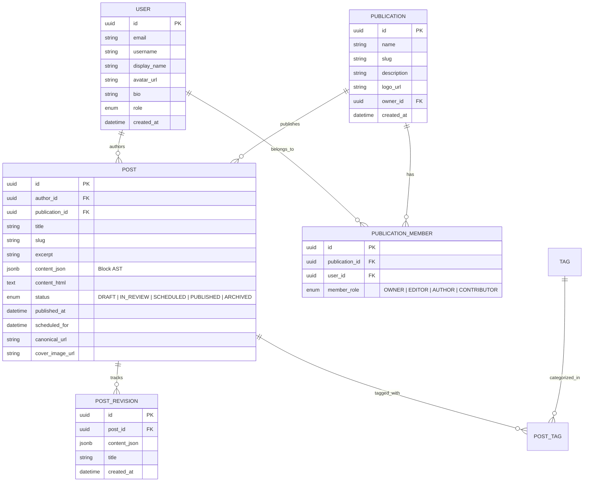

# INKFORGE — System Architecture & Design Specification

## 1. Executive Summary

**INKFORGE** is a high-performance, modular publishing ecosystem designed to scale from a single author's distraction-free writing studio to an enterprise-grade multi-publication editorial platform.

The core philosophy of Inkforge is:
- **Crafted for Writers**: Distraction-free, block-oriented, keyboard-first writing experience with rich block semantics.
- **Optimized for Readers**: Blazing-fast page loads, accessible typography, responsive reading environments, dark/light themes, and SEO performance.
- **Engineered for Scale**: Modular domain architecture that cleanly separates content authoring, storage, workflow orchestration, and multi-tenant publication management.

---

## 2. Platform Evolution Phases

```
┌────────────────────────┐      ┌─────────────────────────┐      ┌─────────────────────────────┐
│       PHASE 1          │      │         PHASE 2         │      │           PHASE 3           │
│  The Writer's Studio   │ ───► │  Editorial & Workflow   │ ───► │    Publishing Ecosystem     │
│                        │      │                         │      │                             │
│ • Block-based Editor   │      │ • Multi-author Orgs     │      │ • Multiple Publications     │
│ • Drafts & Revisions   │      │ • Editorial Roles (RBAC)│      │ • Community & Engagement    │
│ • Fast Reader Front    │      │ • Review & Approvals    │      │ • Newsletters / Syndi-feed  │
│ • Tagging & Metadata   │      │ • Scheduled Publishing  │      │ • Analytics & Memberships   │
└────────────────────────┘      └─────────────────────────┘      └─────────────────────────────┘
```

---

## 3. Recommended Core Tech Stack

| Layer | Recommended Technology | Rationale |
| :--- | :--- | :--- |
| **Framework** | **Next.js 15 (App Router, React 19, TypeScript)** | Industry benchmark for editorial platforms. Combines static site generation (SSG) / ISR for readers with dynamic client interactivity for editors. |
| **Styling & UI** | **Tailwind CSS v4 + Radix UI primitives** | Fluid typography, accessible component primitives, dark/light mode, editorial design system. |
| **Editor Core** | **Tiptap (ProseMirror runtime)** | Extensible block-based editor supporting rich blocks (code syntax highlighting, callouts, tables, embeds, images), slash commands (`/`), and clean JSON/Markdown AST. |
| **Data Layer** | **PostgreSQL + Drizzle / Prisma ORM** | Strong relational integrity for authors, publications, posts, revision history, and collaborative permissions. |
| **Authentication** | **Auth.js (NextAuth v5)** | Session handling, OAuth providers (GitHub, Google), magic links, role-based access control. |
| **Search & SEO** | **Full-Text Search + OpenGraph / JSON-LD** | Native semantic metadata, automatic sitemaps, RSS feeds, schema.org publishing markup. |

---

## 4. Domain Model (Initial Blueprint)



---

## 5. Directory Scaffolding Strategy

```
inkforge/
├── apps/
│   └── web/                   # Next.js Full-Stack App (Editor + Reader + Dashboard)
│       ├── app/
│       │   ├── (auth)/        # Authentication routes (login, register)
│       │   ├── (dashboard)/   # Studio / Writer dashboard & block editor
│       │   ├── (reader)/      # Public blog, publication index & post reader
│       │   └── api/           # Internal REST / tRPC / Server Action endpoints
│       ├── components/
│       │   ├── editor/        # Tiptap block editor & custom block extensions
│       │   ├── reader/        # Article typography, TOC, reading progress
│       │   └── ui/            # Reusable UI primitives (buttons, modals, tooltips)
│       └── lib/               # Utility functions, validation schemas (Zod)
├── packages/
│   ├── database/              # Schema, migrations, client singleton
│   └── config/                # Shared ESLint, TSConfig, Tailwind configs
├── docs/                      # Architectural specs, RFCs, and API docs
├── .gitignore
├── package.json
└── README.md
```
