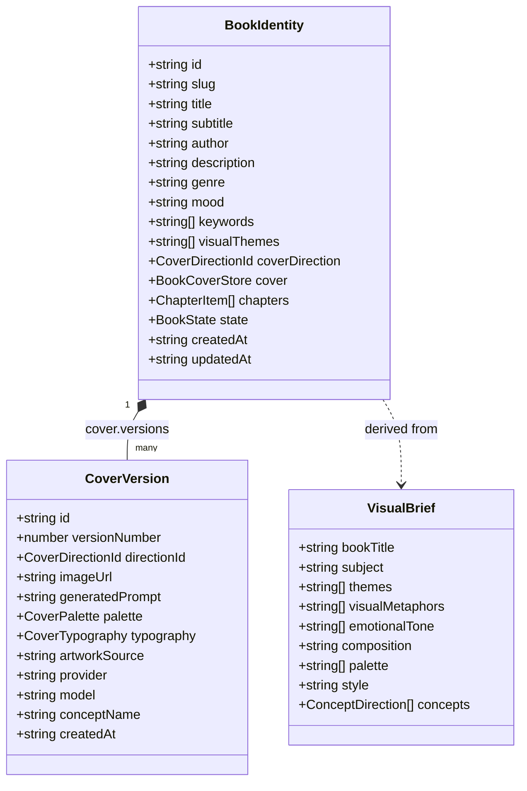

# INKFORGE — AI Book Identity & Adaptive Cover Experience

## Overview

In **INKFORGE**, writing is elevated from ephemeral web articles to bound, archival physical editions:

> **"Every book should look like its story."**

When an author inscribes a manuscript, INKFORGE analyzes the story's actual narrative arc, themes, and conflicts to construct a **Book Identity**:
1. **Story-Derived Artwork**: Portrait fine-art synthesized via a real two-stage AI pipeline (OpenAI GPT-4o & DALL-E 3) with negative space allocated for typography.
2. **Crisp HTML/CSS Typography Overlay**: Pure CSS Charter serif and Editorial mono typography with blind debossing and gold foil hot-stamping.
3. **Cloth Binding & Foil Palette**: Custom buckram, linen, and vellum palettes tailored to the book's mood and genre.
4. **Interactive 3D Physical Book**: The volume rests on the editorial desk, featuring a reversible hinged front cover board and an **Adaptive Creator Workspace Menu** based on the manuscript's lifecycle state (`NEW`, `IN_PROGRESS`, `READY_TO_PUBLISH`, `PUBLISHED`).

---

## 1. Architectural Model & Data Schema

The Book Identity system is typed in [`src/types/book.ts`](file:///Users/kingpin/Documents/Vibecoded%20projects/inkforge/src/types/book.ts) and [`src/types/cover-generator.ts`](file:///Users/kingpin/Documents/Vibecoded%20projects/inkforge/src/types/cover-generator.ts), and persisted locally via [`src/lib/book-store.ts`](file:///Users/kingpin/Documents/Vibecoded%20projects/inkforge/src/lib/book-store.ts).

### Core Entities



---

## 2. The 4 Story-Derived Concept Directions

Instead of preset visual templates, INKFORGE interprets the manuscript into 4 distinct concepts:

| Concept Direction | Symbolic Purpose | Composition Focus |
| :--- | :--- | :--- |
| **Concept A: Visual Metaphor** | Thematic essence & abstract symbolism | Central conceptual motif, high contrast, clean background |
| **Concept B: Character & Environment** | Narrative setting & human solitude | Atmospheric horizon, deep spatial perspective, environmental lighting |
| **Concept C: Minimal Editorial** | Quiet restraint & timeless authority | Vast upper negative space, solitary evocative object, delicate rules |
| **Concept D: Cinematic & Atmospheric** | Dramatic tension & emotional weight | Chiaroscuro lighting, deep shadows, textured grain |

---

## 3. Real Server-Side AI Pipeline

```
Browser (Wizard)
   │
   ├─► POST /api/covers/interpret  (Stage 1: Generates VisualBrief & 4 concepts)
   │
   └─► POST /api/covers/generate   (Stage 2: Synthesizes portrait artwork via DALL-E 3)
```

- **Zero Fake Policy**: If `OPENAI_API_KEY` is not present, the system honestly reports status and displays non-AI alternatives: Handcrafted Editorial Templates (Oxford Buckram, Bordeaux Gilt, Nordic Linen, Bookshop Vellum), custom file upload, or plain bookcloth binding.
- **Persistent Asset Storage**: Generated assets are stored on the server filesystem (`/public/uploads/covers/`) or cloud storage, guaranteeing persistent image availability.

---

## 4. Adaptive Creator Workspace Menu

When an author opens their book on the editorial desk ([`/books/[id]`](file:///Users/kingpin/Documents/Vibecoded%20projects/inkforge/src/app/books/%5Bid%5D/page.tsx)), the right-hand inside page renders an **Adaptive Menu** tailored to the manuscript lifecycle:

- **`NEW`**: Directs author to *"Begin Writing Chapter I"* and explore visual identity.
- **`IN_PROGRESS`**: Highlights *"Continue Writing"*, word count milestones, and chapter outline.
- **`READY_TO_PUBLISH`**: Unlocks proofreading spread and publication colophon inscription.
- **`PUBLISHED`**: Opens reading circulation metrics and e-ink/print export folios.
