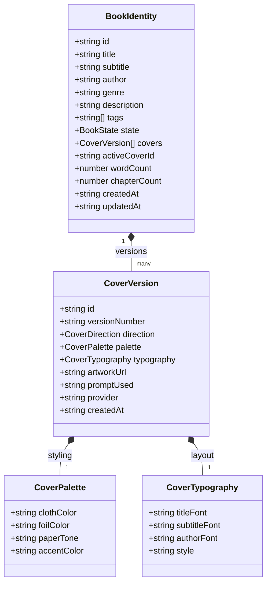
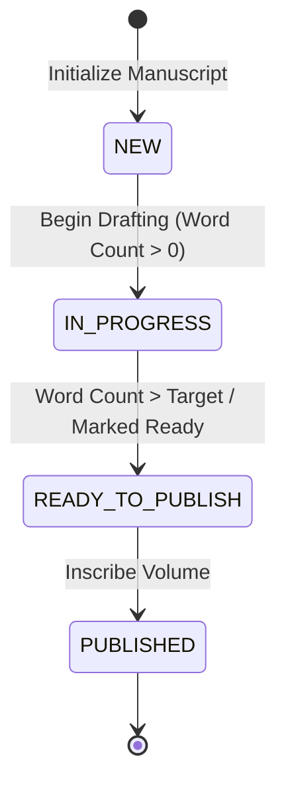

# INKFORGE — AI Book Identity & Adaptive Cover Experience

## Overview

In **INKFORGE**, every piece of writing is treated as more than a detached post or CMS document:

> **Every piece of writing in INKFORGE can become a visually unique, beautifully bound book.**

When a creator starts a new work, INKFORGE synthesizes the manuscript metadata (title, subtitle, description, genre, themes) to generate a distinctive **Book Identity**. This identity includes:
1. **Dynamic 3D Book & Cover Art**: Curated or AI-generated fine art with tactile linen binding, custom cloth color palettes, and foil stamped spines.
2. **Crisp Typographic Compositing**: Pure HTML/CSS typographic overlays in Charter serif and monospace, guaranteeing zero AI hallucinated text and total author editability.
3. **Adaptive Inside Spread**: The 3D open book spread acts as the author's primary workspace, automatically presenting contextual workflows based on the book's lifecycle state.

---

## 1. Architectural Model & Data Schema

The Book Identity system is typed in [`src/types/book.ts`](file:///Users/kingpin/Documents/Vibecoded%20projects/inkforge/src/types/book.ts) and backed by a local-first reactive storage manager in [`src/lib/book-store.ts`](file:///Users/kingpin/Documents/Vibecoded%20projects/inkforge/src/lib/book-store.ts).

### Core Entities

### Cover Design Directions

Authors can explore or combine 4 signature design directions:

| Direction | Aesthetic & Materials | Target Writing |
| :--- | :--- | :--- |
| **`editorial`** | Swiss grid, strict typography, duotone color palettes, architectural geometry | Essays, criticism, philosophy, design theory |
| **`cinematic`** | Moody lighting, atmospheric gradients, atmospheric negative space, rich shadows | Fiction, narrative non-fiction, memoirs, investigative prose |
| **`experimental`** | Asymmetrical typography, expressive abstract forms, avant-garde framing | Poetry, speculative prose, experimental treatises |
| **`classic`** | Traditional bookbinding, leather & cloth textures, gold foil stamping, blind debossing | Historical monographs, timeless manifestos, reference folios |

---

## 2. Adaptive Creator Workspace Menu

When an author opens their book in the 3D folio ([`/books/[id]`](file:///Users/kingpin/Documents/Vibecoded%20projects/inkforge/src/app/books/%5Bid%5D/page.tsx)), the right-hand inside page renders an **Adaptive Menu** tailored to the book's current lifecycle state:

### State-Specific Menu Actions

1. **`NEW` (Fresh Manuscript)**:
   - Primary Focus: Launching the initial chapter draft (`Begin Writing Chapter I`).
   - Secondary Focus: Generating or refining the cover aesthetic (`Cover Identity Studio`).
   - Tertiary Actions: Building the chapter outline, jotting worldbuilding notes.

2. **`IN_PROGRESS` (Active Drafting)**:
   - Primary Focus: Resuming manuscript composition (`Continue Writing Chapter`).
   - Secondary Focus: Navigating the manuscript chapter outline.
   - Tertiary Actions: Archiving cover iterations, proofreading in preview mode.

3. **`READY_TO_PUBLISH` (Manuscript Complete)**:
   - Primary Focus: Entering reader preview (`Proofread Full Spread`).
   - Secondary Focus: Final colophon and publication inscription (`Inscribe & Publish`).
   - Tertiary Actions: Final cover plate inspection.

4. **`PUBLISHED` (Bound Volume)**:
   - Primary Focus: Immersive reading view (`Read Bound Volume`).
   - Secondary Focus: Volume metrics (circulation, reading time, reader engagement).
   - Tertiary Actions: Exporting e-ink folios or print-ready PDF signatures.

---

## 3. Physical Book Integration

The dynamic 3D physical book component ([`src/components/landing/PhysicalBook.tsx`](file:///Users/kingpin/Documents/Vibecoded%20projects/inkforge/src/components/landing/PhysicalBook.tsx)) seamlessly supports both landing page mode (Volume IV flagship edition) and individual manuscript mode (`BookIdentity`):

- **Cloth & Linen Texture**: Dynamically binds with `cover.palette.clothColor` and overlay grain filters.
- **Foil Typography**: Gold, silver, oxblood, or copper foil rendering for titles and debossed frames.
- **Spine Labeling**: Realistic 3D spine geometry with rotated vertical title and author inscription.
- **Inner Spread**:
  - **Left Folio**: Custom ex-libris bookplate, synopsis, genre tag, target words, and creation timestamp.
  - **Right Folio**: The Adaptive Creator Menu with interactive status indicators, action routes, and shortcut keys.

---

## 4. Workflows & User Journeys

### A. Creating a New Book
1. Creator clicks **"New Book"** in the top navigation or editorial ledger.
2. The **Book Creation Wizard** ([`/books/create`](file:///Users/kingpin/Documents/Vibecoded%20projects/inkforge/src/app/books/create/page.tsx)) guides them through 3 steps:
   - **Step 1: Manuscript Dossier** (Title, Subtitle, Author, Genre, Synopsis, Visual Themes).
   - **Step 2: Design Direction** (Editorial, Cinematic, Experimental, Classic).
   - **Step 3: Cover Identity Studio** (Live 3D Book / Flat Plate preview, palette refinement, instant re-generation).
3. Clicking **"Bind Book & Enter Studio"** saves the identity to local storage and transitions directly to the 3D book workspace ([`/books/[id]`](file:///Users/kingpin/Documents/Vibecoded%20projects/inkforge/src/app/books/%5Bid%5D/page.tsx)).

### B. Writing Within a Book's Context
1. From the book workspace or ledger, clicking **"Write"** navigates to `/write?bookId=[id]`.
2. The Scribe Studio detects the active volume:
   - Displays a prominent **Active Book Banner** with spine pill and quick link back to the 3D workspace.
   - Automatically synchronizes title, genre, and word counts with the persistent book identity.
