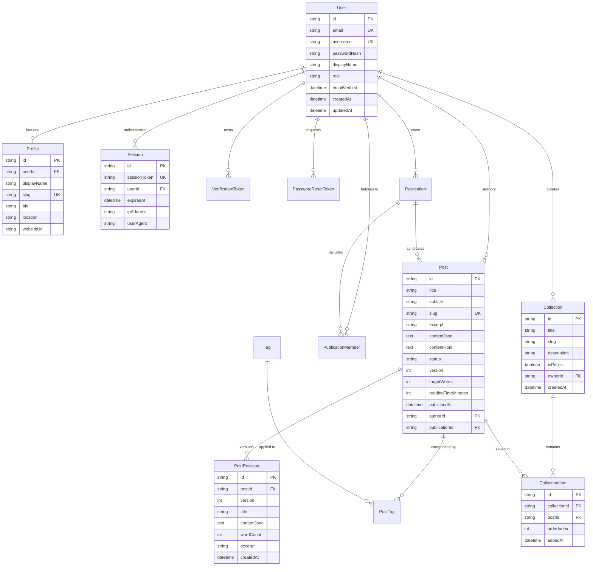

# INKFORGE — Database Schema & Data Modeling

This document provides a complete, code-grounded reference for the **INKFORGE PostgreSQL database schema** managed via Prisma ORM 6.4.1.

---

## 1. Entity-Relationship (ER) Diagram



---

## 2. Model Specifications

### 1. `User`
Central author and reader identity model.
- **`id`** (`String` / UUID, Primary Key): Unique internal user identifier.
- **`email`** (`String`, Unique, Indexed): User email address.
- **`username`** (`String`, Unique, Indexed): Public author handle (e.g. `@elena`).
- **`passwordHash`** (`String`, Nullable): Secure scrypt hash with random salt; null for social OAuth.
- **`displayName`** (`String`, Nullable): Displayed author name in bylines and headers.
- **`role`** (`String`, Default: `"WRITER"`): Role string (`ADMIN`, `EDITOR`, `WRITER`, `READER`).
- **`emailVerified`** (`DateTime`, Nullable): Timestamp of verification; null if pending.
- **Indexes:** `@@index([email])`, `@@index([username])`.

### 2. `Profile`
Extended author biographical metadata.
- **`userId`** (`String`, Foreign Key -> `User.id`, `onDelete: Cascade`): One-to-one link.
- **`displayName`** (`String`): Formatted public name.
- **`slug`** (`String`, Unique, Indexed): Optional URL slug for profile routing.
- **`bio`** (`String`, Nullable): Full author biography.
- **`location`** (`String`, Nullable): Author location or affiliation (e.g. "Vienna, Austria").
- **`websiteUrl`** (`String`, Nullable): External portfolio or blog link.

### 3. `Session`
Stateful, secure session tracking.
- **`sessionToken`** (`String`, Unique): Cryptographically random 64-character token stored in HTTP-only cookies.
- **`userId`** (`String`, Foreign Key -> `User.id`, `onDelete: Cascade`).
- **`expiresAt`** (`DateTime`, Indexed): Absolute session expiration timestamp.
- **`ipAddress`** / **`userAgent`** (`String`, Nullable): Security audit metadata.

### 4. `VerificationToken` & `PasswordResetToken`
Single-use cryptographic security tokens.
- **`tokenHash`** (`String`, Unique): SHA-256 hash of the single-use token delivered to the user.
- **`expiresAt`** (`DateTime`, Indexed): Token validity deadline (typically 1 hour).
- **`onDelete: Cascade`:** Deleting the user immediately purges all pending tokens.

### 5. `Post` (Manuscripts & Monographs)
The primary publishing unit in INKFORGE.
- **`id`** (`String` / UUID, Primary Key): Immutable document ID.
- **`title`** (`String`): Monograph title.
- **`subtitle`** (`String`, Nullable): Monograph subtitle or deck line.
- **`slug`** (`String`, Unique, Indexed): URL-safe public reading slug (e.g. `crafting-systems-that-endure`).
- **`excerpt`** (`String`, Nullable): Brief opening synopsis used in catalogues and meta tags.
- **`contentJson`** (`String`, Nullable): Structured ProseMirror AST JSON string.
- **`contentHtml`** (`String`, Nullable): Pre-rendered HTML for instant reader loading without client parsing overhead.
- **`status`** (`String`, Default: `"DRAFT"`, Indexed): Lifecycle state (`DRAFT`, `IN_REVIEW`, `SCHEDULED`, `PUBLISHED`, `ARCHIVED`).
- **`version`** (`Int`, Default: 1): Monotonically incrementing sync counter for optimistic concurrency.
- **`targetWords`** (`Int`, Default: 1200): Word count milestone goal.
- **`readingTimeMinutes`** (`Int`, Default: 1): Precomputed estimated reading duration based on word count.
- **`publishedAt`** (`DateTime`, Nullable, Indexed): Timestamp of public inscription.
- **`canonicalUrl`** (`String`, Nullable): Canonical URL for SEO syndication.
- **`authorId`** (`String`, Foreign Key -> `User.id`, `onDelete: Cascade`, Indexed).
- **`publicationId`** (`String`, Foreign Key -> `Publication.id`, Nullable, `onDelete: SetNull`, Indexed).

### 6. `PostRevision`
Immutable historical version snapshots.
- **`postId`** (`String`, Foreign Key -> `Post.id`, `onDelete: Cascade`, Indexed).
- **`version`** (`Int`): Revision counter matching the document's state at snapshot time.
- **`title`** (`String`): Title at the time of revision.
- **`contentJson`** (`String`): Full AST JSON snapshot.
- **`wordCount`** (`Int`): Word count at the time of revision.
- **`createdAt`** (`DateTime`): Checkpoint creation timestamp.

### 7. `Collection` & `CollectionItem`
Thematic slipcases and curated reading lists.
- **`Collection.id`** (`String`, Primary Key).
- **`Collection.title`** (`String`): Anthology title (e.g. "Systems & Architecture").
- **`Collection.slug`** (`String`): Anthology URL slug.
- **`Collection.isPublic`** (`Boolean`, Default: `true`, Indexed): Visibility toggle.
- **`Collection.ownerId`** (`String`, Foreign Key -> `User.id`, `onDelete: Cascade`, Indexed).
- **`CollectionItem.collectionId`** (`String`, Foreign Key -> `Collection.id`, `onDelete: Cascade`, Indexed).
- **`CollectionItem.postId`** (`String`, Foreign Key -> `Post.id`, `onDelete: Cascade`, Indexed).
- **`CollectionItem.orderIndex`** (`Int`, Default: 0): Sorting order within the anthology.
- **Constraints:** `@@unique([ownerId, slug])` on Collection; `@@unique([collectionId, postId])` on CollectionItem.

---

## 3. Dual-Schema Strategy

INKFORGE maintains two synchronized schema files:
1. **`prisma/schema.postgresql.prisma`:** Production PostgreSQL schema with `directUrl` for connection-pooled serverless environments.
2. **`prisma/schema.prisma`:** Local SQLite development schema for zero-dependency offline prototyping.

The build script in [`package.json`](file:///Users/kingpin/Documents/Vibecoded%20projects/inkforge/package.json) automatically detects `DATABASE_URL` and routes migrations and Prisma client generation to PostgreSQL on production builds:
```bash
npm run prisma:generate   # Generates Prisma client from schema.postgresql.prisma
npm run db:migrate:deploy # Applies migrations to PostgreSQL via session pooler
```
