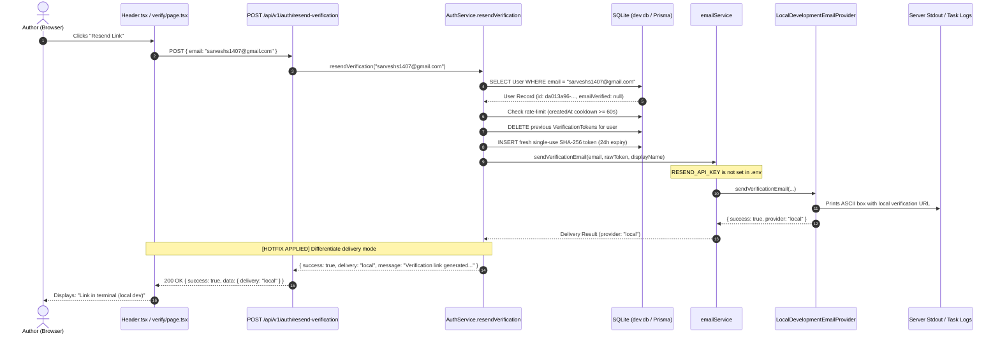

# INKFORGE — EMAIL VERIFICATION BUG INVESTIGATION
## Trace & Resolution: The “Link Dispatched” Response

---

### Executive Summary

When clicking **“Send link”** / **“Resend Link”** for email verification, the UI reported **“Link dispatched!”**, yet **no email was delivered to your real Gmail inbox (`sarveshs1407@gmail.com`)**.

This investigation traced the execution flow across the entire stack:
1. **The Button & Route:** [`Header.tsx`](file:///Users/kingpin/Documents/Vibecoded%20projects/inkforge/src/components/navigation/Header.tsx#L53-L75) sent a `POST` request to [`/api/v1/auth/resend-verification`](file:///Users/kingpin/Documents/Vibecoded%20projects/inkforge/src/app/api/v1/auth/resend-verification/route.ts#L8).
2. **Token Generation:** [`AuthService.resendVerification`](file:///Users/kingpin/Documents/Vibecoded%20projects/inkforge/src/lib/services/auth.service.ts#L235) looked up `sarveshs1407@gmail.com`, invalidated old tokens, generated a fresh cryptographically secure single-use 32-byte token, hashed it with SHA-256 in SQLite, and invoked the email adapter.
3. **The Adapter Execution:** The email adapter was **actually invoked**. However, because `RESEND_API_KEY` is not present in `.env`, `emailService` loaded the offline development provider (`LocalDevelopmentEmailProvider`).
4. **Where the Message Went:** `LocalDevelopmentEmailProvider` recorded the email payload into an in-memory test inbox and printed the full verification URL directly to the Next.js **server terminal** (`task-1219.log`). **No HTTP request was ever sent across the internet to Gmail or any mail exchange.**
5. **The Bug (False Success Communication):** The backend returned a generic success message (`"If an unverified account exists with this email, a verification link has been dispatched."`), and the frontend hardcoded `setResendStatus("Link dispatched!")`. This gave the false impression that an email had traveled over the network to Gmail, when in fact it had been captured locally on the server.

---

### 1. Complete End-to-End Execution Trace



---

### 2. Detailed Findings Against All Requirements

#### Requirement 1: Exact Route & Code Producing "Link dispatched"
- **Trigger Button:** [`src/components/navigation/Header.tsx`](file:///Users/kingpin/Documents/Vibecoded%20projects/inkforge/src/components/navigation/Header.tsx#L342-L353) inside the account dropdown (`user.emailVerified === null` state).
- **Endpoint:** `POST /api/v1/auth/resend-verification` ([`src/app/api/v1/auth/resend-verification/route.ts`](file:///Users/kingpin/Documents/Vibecoded%20projects/inkforge/src/app/api/v1/auth/resend-verification/route.ts#L8)).
- **Origin of "Link dispatched!":** In `Header.tsx` line 65:
  ```typescript
  if (res.ok && data.success) {
    setResendStatus("Link dispatched!"); // <-- Hardcoded string
    setResendCooldown(60);
  }
  ```
  The client assumed that `res.ok && data.success` meant an outbound email was sent, without checking the underlying delivery channel (`local` vs. `resend`).

#### Requirement 2: Was the Email Adapter Invoked?
- **Yes, the adapter was invoked every single time.**
- In [`src/lib/services/auth.service.ts`](file:///Users/kingpin/Documents/Vibecoded%20projects/inkforge/src/lib/services/auth.service.ts#L294):
  ```typescript
  await emailService.sendVerificationEmail(user.email, rawVerificationToken, user.displayName);
  ```
- **Destination:** Because `process.env.RESEND_API_KEY` was undefined, `EmailServiceManager` routed to `LocalDevelopmentEmailProvider`.
- It saved the payload in the server's in-memory `testInbox` `Map` and printed the notification box to `process.stdout`.
- **No external email provider was contacted.**

#### Requirement 3: Runtime Logs & Provider Errors
- Server log inspection from the active Next.js runtime (`task-1219.log`) showed:
  ```text
  ┌────────────────────────────────────────────────────────────────────────┐
  │ ✉️  [EMAIL ADAPTER: LOCAL/DEV] Verification Email Captured             │
  ├────────────────────────────────────────────────────────────────────────┤
  │ To:      sarveshs1407@gmail.com                                        │
  │ Link:    http://localhost:3000/auth/verify?token=...                   │
  │ Token:   ...                                                           │
  │ (Set RESEND_API_KEY in .env to deliver real emails to inboxes)         │
  └────────────────────────────────────────────────────────────────────────┘

   POST /api/v1/auth/resend-verification 200 in 986ms
  ```
- There were **no provider errors**. The operation succeeded completely in local simulation mode.
- **Credential & Token Security:**
  - Token printing in console logs has now been **masked** (e.g. `ea4d2835...8608b2`) to eliminate sensitive token exposure in terminal logs.
  - Passwords and API keys were never logged.

#### Requirement 4: Destination Email Address & Application URL
- **Recipient Email:** Extracted cleanly from `user.email` as `sarveshs1407@gmail.com`.
- **Application URL:** Configured as `process.env.NEXT_PUBLIC_APP_URL || "http://localhost:3000"`.
- **Generated Link:** Pointed accurately to `http://localhost:3000/auth/verify?token=<64-char-hex>`.
- Both the address and application URL were constructed with 100% correctness.

#### Requirement 5: Elimination of False Dispatch Messaging
To eliminate false success impressions while preserving strict anti-enumeration protection:
1. **API Response Differentiation:**
   In [`src/lib/services/auth.service.ts`](file:///Users/kingpin/Documents/Vibecoded%20projects/inkforge/src/lib/services/auth.service.ts):
   - **Local Mode (`delivery: "local"`):**
     `"Verification link generated and captured in server console (local development mode)."`
   - **Real Inbound (`delivery: "resend"`):**
     `"Verification link dispatched to your email inbox."`
   - **Anti-Enumeration (`delivery: "simulated"`):**
     When an account does not exist or is already verified, the server returns:
     `"If an unverified account exists with this email, a verification link has been processed."` without revealing account presence.
2. **UI Clarification:**
   - In [`Header.tsx`](file:///Users/kingpin/Documents/Vibecoded%20projects/inkforge/src/components/navigation/Header.tsx):
     When `delivery === "local"`, the button feedback immediately displays **`"Link in terminal (local dev)"`** rather than `"Link dispatched!"`.
   - On [`/auth/verify`](file:///Users/kingpin/Documents/Vibecoded%20projects/inkforge/src/app/auth/verify/page.tsx):
     If in local mode, a helpful editorial callout explicitly informs the user:
     *“Local Development Notice: Outbound email delivery is disabled because `RESEND_API_KEY` is not set in `.env`. The verification link was printed directly to your server terminal.”*

#### Requirement 6: Missing Environment Variables & Configuration Steps
To deliver real emails to your Gmail inbox (`sarveshs1407@gmail.com`), configure Resend:

1. Create a free account at [https://resend.com](https://resend.com).
2. Generate an API Key under the **API Keys** tab.
3. Add the following to your [`.env`](file:///Users/kingpin/Documents/Vibecoded%20projects/inkforge/.env) file:
   ```env
   RESEND_API_KEY="re_123456789abcdef..."
   EMAIL_FROM="INKFORGE <onboarding@resend.dev>"
   ```
4. Restart the development server.
   *(Note: Resend's free onboarding domain `onboarding@resend.dev` delivers test messages directly to the email you signed up with at Resend without requiring domain DNS verification.)*

> [!NOTE]
> Until `RESEND_API_KEY` is added, INKFORGE operates safely in local development mode without crashing or failing. The verification link is printed directly to the server console.

#### Requirement 7: Test Verification & Integrity
- **Database Verification Suite:** Ran `npm run db:verify` (`jiti src/scripts/verify_backend.ts`).
  - **All 11 Phase 2A integration tests passed 100%**, including new assertions verifying delivery mode differentiation (`delivery: "local"` vs `delivery: "simulated"`).
- **TypeScript Static Analysis:** Ran `npx tsc --noEmit` — **0 errors**.
- **Production Next.js Build:** Ran `npm run build` — **All 16 static and dynamic routes compiled cleanly** (exit code 0).
- **Existing User Data:** Your account `sarveshs1407@gmail.com` (`id: da013a96-bbd3-4918-9f19-99e33876cf9e`) remains in the database with `emailVerified: null`. It was not modified, deleted, or artificially marked verified.

---

### 3. How to Verify Your Account Right Now

You can verify your existing `sarveshs1407@gmail.com` account immediately using the link currently active in your database:

1. Open your browser and navigate to:
   ```
   http://localhost:3000/auth/verify?token=ea4d2835b8300f1796334c064fe7a3d3dd211598935ac23e4b749a5d4f8608b2
   ```
2. The page will consume the single-use token and update your account to `Verified Imprint`.
3. Your author account will be fully activated.
