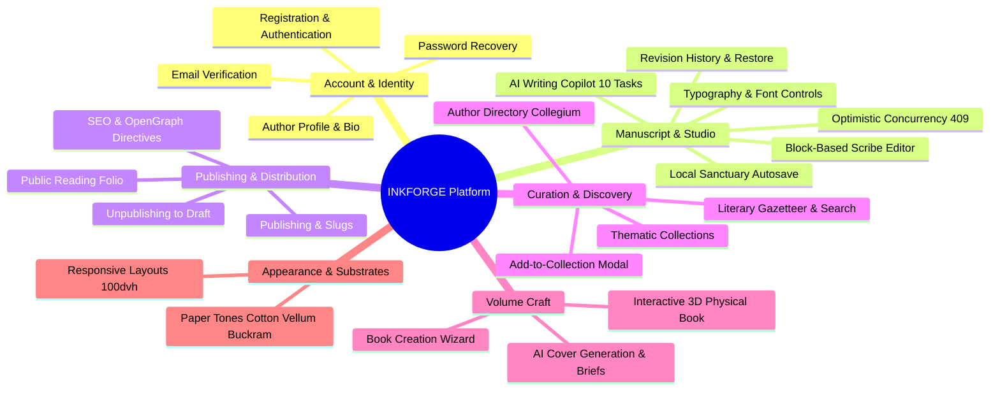

# INKFORGE — Feature Reference & Technical Capabilities

This document provides an exhaustive, code-grounded catalog of every feature implemented across INKFORGE. It details user-facing functionality, backend mechanics, data contracts, and known limitations.

---

## 1. Feature Map & Domain Index

---

## 2. Account & Authentication

### Overview
INKFORGE implements an authenticated author sanctuary built on cryptographically hashed passwords (`bcryptjs`/PBKDF2), HTTP-only session cookies (`session_token`), and session persistence in PostgreSQL/SQLite.

### Implemented Capabilities

#### 1. Author Registration
- **Code Path:** [`src/components/auth/SignInModal.tsx`](file:///Users/kingpin/Documents/Vibecoded%20projects/inkforge/src/components/auth/SignInModal.tsx), [`src/app/api/v1/auth/register/route.ts`](file:///Users/kingpin/Documents/Vibecoded%20projects/inkforge/src/app/api/v1/auth/register/route.ts), [`src/lib/services/auth.service.ts`](file:///Users/kingpin/Documents/Vibecoded%20projects/inkforge/src/lib/services/auth.service.ts).
- **Behavior:** Accepts `email`, `password` (minimum 8 characters), `username` (alphanumeric with dashes/underscores), and optional `displayName`.
- **Database Operations:** Creates `User` and empty `Profile` records within an atomic transaction.
- **Session Handshake:** Generates a secure session token stored in `Session`, serialized into an `HttpOnly`, `SameSite=Lax`, `Secure` (in production) cookie (`session_token`).
- **Post-Registration State:** Emits the `inkforge_auth_change` window event and presents a persistent success confirmation view with an explicit "Proceed to Sanctuary" button.

#### 2. Author Authentication & Login
- **Code Path:** `SignInModal.tsx`, [`src/app/api/v1/auth/login/route.ts`](file:///Users/kingpin/Documents/Vibecoded%20projects/inkforge/src/app/api/v1/auth/login/route.ts).
- **Behavior:** Validates credentials against hashed password. Preserves entered email upon validation error.
- **Lockout & Security:** Returns standardized `401 Unauthorized` without revealing whether email or password was invalid.

#### 3. Session Revocation & Sign Out
- **Code Path:** [`src/components/navigation/Header.tsx`](file:///Users/kingpin/Documents/Vibecoded%20projects/inkforge/src/components/navigation/Header.tsx), [`src/app/api/v1/auth/logout/route.ts`](file:///Users/kingpin/Documents/Vibecoded%20projects/inkforge/src/app/api/v1/auth/logout/route.ts).
- **Behavior:** Deletes the `Session` record from the database and instructs the browser to expire the `session_token` cookie (`Max-Age=0`). Clears local state and dispatches `inkforge_auth_change`.

#### 4. Email Verification & Imprint Badges
- **Code Path:** [`src/app/auth/verify/page.tsx`](file:///Users/kingpin/Documents/Vibecoded%20projects/inkforge/src/app/auth/verify/page.tsx), [`src/app/api/v1/auth/verify-email/route.ts`](file:///Users/kingpin/Documents/Vibecoded%20projects/inkforge/src/app/api/v1/auth/verify-email/route.ts), [`src/app/api/v1/auth/resend-verification/route.ts`](file:///Users/kingpin/Documents/Vibecoded%20projects/inkforge/src/app/api/v1/auth/resend-verification/route.ts).
- **Verification Delivery:** 
  - When `RESEND_API_KEY` is configured: sends HTML verification email via Resend.
  - When `RESEND_API_KEY` is empty (local dev): prints verification link directly to the Node.js terminal console.
- **Badge Indication:** In the header user dropdown, verified users display a green "Verified Imprint" badge. Unverified users display an amber "Unverified" pulse with an in-dropdown "Resend Link" button (throttled by a 60-second cooldown timer).

#### 5. Password Reset & Account Recovery
- **Code Path:** [`src/app/auth/reset-password/page.tsx`](file:///Users/kingpin/Documents/Vibecoded%20projects/inkforge/src/app/auth/reset-password/page.tsx), [`src/app/api/v1/auth/forgot-password/route.ts`](file:///Users/kingpin/Documents/Vibecoded%20projects/inkforge/src/app/api/v1/auth/forgot-password/route.ts), [`src/app/api/v1/auth/reset-password/route.ts`](file:///Users/kingpin/Documents/Vibecoded%20projects/inkforge/src/app/api/v1/auth/reset-password/route.ts).
- **Behavior:** Two-step flow:
  1. User submits email $\rightarrow$ Single-use `PasswordResetToken` (expires in 1 hour) dispatched via email or terminal.
  2. User opens link `/auth/reset-password?token=...` $\rightarrow$ Page verifies token validity on mount via `GET /api/v1/auth/reset-password?token=...` before displaying the password form.
  3. Upon password update, invalidates the token and updates the user's password hash.

---

## 3. Manuscript Creation & Management

### Overview
Manuscript management is orchestrated between Scribe Studio ([`/write`](file:///Users/kingpin/Documents/Vibecoded%20projects/inkforge/src/app/%28studio%29/write/page.tsx)) and the Author's Manuscript Ledger ([`/posts`](file:///Users/kingpin/Documents/Vibecoded%20projects/inkforge/src/app/%28studio%29/posts/page.tsx)).

### Implemented Capabilities

#### 1. Manuscript Ledger Dashboard (`/posts`)
- **Filter Tabs:**
  - `ALL`: Complete catalog of manuscripts.
  - `DRAFT`: Unpublished private drafts.
  - `IN_REVIEW`: Monographs flagged for editorial evaluation.
  - `SCHEDULED`: Pieces queued for upcoming releases.
  - `PUBLISHED`: Public monographs live in the reader.
- **Manuscript Card Actions:**
  - **Edit Manuscript:** Opens piece in Scribe Studio (`/write?id=[postId]`).
  - **Open Public Monograph:** Links to `/read/[slug]` for published pieces.
  - **Delete Work:** Executes `DELETE /api/v1/documents/:id` with browser confirmation, removing the piece and all related revisions.
  - **Status Badge:** Visual indicator showing publication state, version number, and last saved timestamp.

#### 2. Local-First Draft Persistence & Migration
- **Code Path:** [`src/lib/drafts/draft-manager.ts`](file:///Users/kingpin/Documents/Vibecoded%20projects/inkforge/src/lib/drafts/draft-manager.ts).
- **Local Sanctuary:** Drafts written before authentication or during offline conditions are buffered locally in browser storage (`localStorage`).
- **Sync Banner:** When an unauthenticated draft exists and the user signs in, a persistent top banner prompts: *"Local Draft(s) Detected in this Browser — Would you like to sync your legacy local drafts into your permanent authenticated author ledger?"*
- **Execution:** Clicking "Sync to Ledger" iterates over local drafts, issues `POST /api/v1/documents`, and marks them as migrated without data loss.

---

## 4. Writing Studio (Scribe Studio)

### Overview
Located at `/write`, the Scribe Studio is INKFORGE's flagship authoring canvas, built on Tiptap (ProseMirror engine) with an Abstract Syntax Tree (AST) architecture.

### Implemented Capabilities

#### 1. Semantic Block Editor
- **Tiptap StarterKit:** Paragraphs, Headings (H1 Main Title, H2 Section Title, H3 Subsection), Bullet Lists, Ordered Lists, Code Blocks, Pullquotes, Horizontal Pause Rules.
- **Custom Extensions:**
  - **Hyperlinks:** `CustomLink` extension supporting `Cmd+K` keyboard shortcut, destination URL validation, and link removal dialog.
  - **Illustrations:** `CustomImage` extension supporting URL embedding with optional scholarly caption attribution.
  - **Editorial Tables:** `TableBlock` extension embedding structured 3-column comparative grids with markdown/JSON serialization.
  - **Highlight:** `Highlight` mark (`Cmd+Shift+H`) providing subtle ink-wash emphasis.
  - **Code:** Inline code (`Cmd+E`) and syntax-styled code blocks.

#### 2. Typographic Scale & Font Switcher
- **Toolbar Dropdowns:**
  - **Font Family:** Toggle between Editorial Serif (Charter/Newsreader), Book Garamond (EB Garamond), Modern Sans, or Monospaced Script.
  - **Typographic Scale:** Adjust body text sizing across 16px, 18px (Default), 20px, and 22px without breaking layout constraints.

#### 3. Real-Time Cadence & Metrics Strip
Located at the bottom of the editor canvas:
- Live word count, character count, and estimated reading time ($220\text{ words/minute}$).
- **Editorial Rhythm Classifier:** Dynamically categorizes prose volume:
  - $0\text{ words}$: *"Blank Leaf"*
  - $< 300\text{ words}$: *"Epigram / Sketch"*
  - $< 800\text{ words}$: *"Critical Essay"*
  - $< 1800\text{ words}$: *"Treatise"*
  - $\ge 1800\text{ words}$: *"Extended Monograph"*
- Word Count Target Progress Bar against user-defined goals.

#### 4. Local Sanctuary Autosave & Status Indicator
- **Debounced Save:** Changes trigger an automatic save after 1.5 seconds of typing inactivity or manual shortcut (`Cmd+S`).
- **Save Status States:**
  - `saving`: Amber pulse *"Preserving to ledger..."*
  - `saved`: Green checkmark *"Archived (hh:mm:ss)"*
  - `offline_saved`: Blue badge *"Buffered in Local Sanctuary"*
  - `unsaved`: Amber warning *"Unsaved Changes"*
  - `conflict`: Oxblood badge *"Version Conflict (409)"*
  - `error`: Warning badge *"Save Failed (Local Copy Kept)"*

#### 5. Optimistic Concurrency Control (Version 409 Conflict Resolution)
- **Problem:** Authors editing the same manuscript across multiple tabs or devices could overwrite edits.
- **Implementation:** Every document carries an integer `version`. Updates send the expected `version`. If the server has a higher version, it rejects the request with HTTP `409 Conflict` and returns the latest server snapshot.
- **Conflict Resolution UI:** Displays an alert banner offering three explicit choices:
  1. **Keep My Changes (Overwrite):** Force-increments server version with local prose.
  2. **Load Server Version:** Replaces local editor with the remote server version.
  3. **Copy Local Prose:** Copies current unsaved text to clipboard for manual merging.

#### 6. Revision History & Rollback Drawer
- **Drawer Trigger:** "Revisions" button in the studio action bar.
- **Backend Route:** `GET /api/v1/documents/:id/revisions`.
- **Display:** Chronological list of historical snapshots with version numbers, timestamps, word counts, and excerpts.
- **Restoration:** Clicking "Restore Revision" loads that historical snapshot into the active Tiptap editor and triggers an autosave with an incremented version number.

#### 7. Solitary Focus Mode
- **Trigger:** Maximize icon button in studio header.
- **Behavior:** Completely unmounts the application navigation header and studio distraction elements. Replaces them with a minimal floating top bar showing only word count, save pulse, and AI trigger.

#### 8. Proof Mode
- **Trigger:** "Proof Mode" eye icon toggle.
- **Behavior:** Renders the manuscript through [`SafeContentRenderer`](file:///Users/kingpin/Documents/Vibecoded%20projects/inkforge/src/components/content/SafeContentRenderer.tsx), showing exactly how the published folio will appear in the public reader, with drop caps, pullquotes, and formatted code blocks.

---

## 5. AI Writing Copilot

### Overview
Accessible via `Cmd+J` or the "AI Copilot" toolbar button, [`AiCopilotPanel.tsx`](file:///Users/kingpin/Documents/Vibecoded%20projects/inkforge/src/components/editor/AiCopilotPanel.tsx) provides a literary writing assistant supporting 10 distinct editorial tasks.

### Supported Tasks & Capabilities

| Task ID | Task Label | Scope | Purpose & Behavior |
| :--- | :--- | :--- | :--- |
| `rewrite` | **Rewrite Selection** | Selection | Rephrases highlighted text for enhanced rhythm, cadence, and clarity. |
| `grammar` | **Grammar & Clarity** | Selection | Polishes syntax, fixes mechanical typos, and eliminates awkward phrasing. |
| `tone` | **Adjust Tone** | Selection | Shifts voice between *Formal*, *Conversational*, *Persuasive*, and *Lyrical*. |
| `shorten` | **Make Concise** | Selection | Condenses prose, eliminates filler, and distills core arguments. |
| `expand` | **Expand & Elaborate** | Selection | Enriches arguments with sensory detail, historical parallels, or depth. |
| `continue` | **Continue Writing** | Cursor | Picks up the cadence of the preceding paragraphs and advances the prose. |
| `titles` | **Suggest Titles** | Document | Generates 5 literary title alternatives and subtitle concepts based on text. |
| `outline` | **Structure & Outline**| Document | Drafts a Roman-numeral structural outline analyzing themes and transitions. |
| `qa` | **Manuscript Q&A** | Document | Answers analytical questions regarding consistency, motifs, or clarity. |
| `consistency`| **Consistency Audit** | Document | Audits character names, chronological flow, and voice consistency. |

### Architectural Guardrails
- **Zero Client-Side API Keys:** All AI requests route through server endpoint `POST /api/v1/ai/copilot`.
- **Provider Failover:** Server dynamically chooses between Google Gemini (`gemini-2.5-flash`), OpenAI (`gpt-4o-mini`), or the built-in Local Editorial Mock engine if no external API key is configured.
- **Sliding-Window Rate Limiting:** Enforces a maximum of 30 requests per minute per author.
- **Side-by-Side Diff Review:** Suggestions are displayed in a comparison pane. Authors must explicitly click "Apply Replacement" or "Insert at Cursor" to modify their manuscript.

---

## 6. Publishing Workflow

### Overview
Monographs transition from private drafts into public reading folios through an explicit publishing ceremony.

### Implemented Capabilities

#### 1. Publishing Transition (`POST /api/v1/documents/:id/publish`)
- **Validation:** Confirms title is present and authenticated author owns the document.
- **Slug Generation:** Automatically generates a URL slug from the title via `slugify` (or validates custom slug).
- **Database State:** Updates `status = "PUBLISHED"`, records `publishedAt = new Date()`, and bumps `version`.
- **Celebration Modal:** Displays a completion modal with the live public reader URL (`/read/[slug]`), copy-to-clipboard button, and direct navigation link.

#### 2. Unpublishing Transition (`POST /api/v1/documents/:id/unpublish`)
- **Behavior:** Reverts `status = "DRAFT"`. Immediately revokes public access to the URL; subsequent visits to `/read/[slug]` return a 404 Folio Not Found error or require author authentication.

#### 3. SEO, Robots & OpenGraph Directives
- **Published Pages:** Include canonical OpenGraph metadata, article author attributions, and allow indexing (`index: true, follow: true`).
- **Private Drafts:** Strictly inject `noindex, nofollow` headers to protect intellectual privacy.

---

## 7. Reading Experience & Public Folio

### Overview
Served at `/read/[slug]`, the public reading experience is an homage to classical book typography.

### Implemented Capabilities

#### 1. Typography & Layout
- **Drop Caps:** Classical two-line initial capital letter on the opening paragraph (`.drop-cap`).
- **Charter & Newsreader Type:** High-contrast serif text optimized for long-form reading comfort.
- **Reading Progress Bar:** Fixed hairline progress indicator at the very top of the browser tracking scroll completion percentage.
- **Footnotes & Sidenotes:** Interactive numeric footnote badges (`activeFootnote`) revealing context notes in an archival popover card.

#### 2. Reader Customization Controls
- **Font Sizing:** Switch between *Standard* ($18\text{px}$), *Large* ($20\text{px}$), and *Generous* ($23\text{px}$).
- **Paper Tone Switcher:** Instant switching between Cotton Ivory, Bookshop Vellum, and Midnight Buckram.
- **Solitary Reading Mode:** Maximizes canvas, removes navigation bars, and centers prose.

#### 3. Social & Curatorial Actions
- **Bookmark & Add to Collection:** Opens `AddToCollectionModal` to save the monograph into private or public anthologies.
- **Share Folio:** Copies canonical URL to clipboard with confirmation toast.
- **Author Folio Link:** Deep-links to the author's biography and complete bibliography at `/authors/[username]`.
- **Chapter Sequencing:** Displays the next sequential chapter or related essay at the foot of the folio.

---

## 8. Discover, Search & Catalog

### Overview
Located at `/discover`, the Literary Gazetteer provides a searchable catalog of published monographs and essays.

### Implemented Capabilities

- **Real-Time Search:** Live debounced search querying titles, excerpts, and author names.
- **Topic Filter Chips:** Categorical filtering across *ALL*, *SYSTEMS CRAFT*, *LITERARY ECOLOGY*, and *DIGITAL THEORY*.
- **Reading Time Slider:** Filters essays by maximum estimated reading duration (e.g., $< 5\text{ mins}$, $< 10\text{ mins}$).
- **Pagination:** Clean 10-item pagination with previous/next controls and total item counters.
- **Monograph Cards:** Displays topic kicker, reading time, author name, excerpt, and bookmark trigger.

---

## 9. Thematic Collections & Anthologies

### Overview
Located at `/collections`, this module enables authors and readers to organize monographs into thematic anthologies.

### Implemented Capabilities

- **Two-Tier Filtering:** Toggle between *Public Anthologies* (curated by the community) and *My Private Folios* (accessible only to the logged-in user).
- **Collection Management:**
  - **Create Collection:** Modal accepting title, description, and public/private visibility toggle.
  - **Edit Collection:** Update metadata or change visibility.
  - **Delete Collection:** Removes anthology record without deleting underlying posts.
- **Story Curation:**
  - Add stories via the `AddToCollectionModal` present across reader and discover views.
  - Remove stories from an anthology with a single click.
  - Ordered index tracking (`orderIndex`) preserving intended reading sequence.

---

## 10. Author Directory & Profiles

### Overview
Located at `/authors` (directory) and `/authors/[username]` (individual folios).

### Implemented Capabilities

- **Author Directory (`/authors`):** Lists all registered authors with published monographs, displaying bio snippets, publication counts, and featured works.
- **Author Folio (`/authors/[username]`):** 
  - Author identity banner with avatar, display name, handle, role, location, and website.
  - Full catalog of published monographs with reading times and dates.
  - If the viewing user is the author: displays an "Edit Profile" shortcut button.
- **Profile Settings (`/profile`):** Authenticated form to update display name, biography, geographical location, and website link (`PATCH /api/v1/auth/me`).

---

## 11. Book Creation Wizard & 3D Volume Craft

### Overview
Located at `/books/create` and `/books/[id]`, this system allows authors to assemble complete volumes with AI-assisted cover design.

### Implemented Capabilities

- **3-Step Creation Wizard (`BookCreationWizard.tsx`):**
  1. **Volume Identity:** Title, subtitle, genre preset, mood preset, keywords, and narrative direction.
  2. **AI Visual Brief Interpretation:** Calls `/api/covers/interpret` to extract symbolic motifs, color palettes, and typographic styles from the book description.
  3. **Cover Studio:** Real-time 3D PhysicalBook preview vs. flat cover art, foil stamping controls (gold foil, silver foil, debossed blind stamp), and AI artwork generation via `/api/covers/generate`.
- **Volume Workspace (`/books/[id]`):** Interactive 3D book viewer allowing authors to preview chapters, outline notes, and inspect cover versions.
