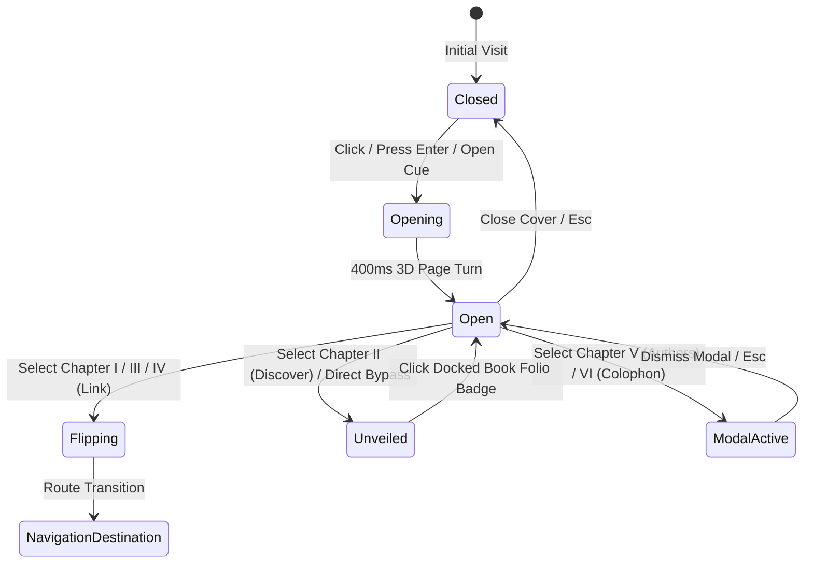

# INKFORGE — Interactive Book Landing Page & Navigation System

## Architectural Overview

The **Interactive Book Landing Page** is a signature entry experience for **INKFORGE**. Instead of greeting authors and readers with a standard marketing SaaS hero layout, INKFORGE introduces an interactive physical metaphor:

> **A tactile, digital book resting on an ambient desk that serves as the platform's spatial navigation system.**

Critically, this design operates as an **entry and navigation portal** rather than forcing the entire functional application into a skeuomorphic book shell. Once a chapter is selected or when the user chooses to explore the live gazetteer, the interface transitions smoothly into the modern, high-velocity INKFORGE living editorial experience.

---

## 1. State Machine Architecture

The entry experience is governed by a robust state machine in [`src/components/landing/InkforgeLanding.tsx`](file:///Users/kingpin/Documents/Vibecoded%20projects/inkforge/src/components/landing/InkforgeLanding.tsx):

### State Definitions
1. **`closed`**: The volume rests on the editorial desk. Displays the blind-debossed cover, cloth texture, Volume IV gold foil typography, silk bookmark ribbon, and tactile invitation to open.
2. **`opening`**: Performs a smooth CSS 3D perspective fold (`rotateY`), transitioning into the spread.
3. **`open`**: Renders the complete two-page editorial spread:
   - **Left Page (Folio 1)**: Colophon, Volume Inscription, Frontispiece vignette, and issue statistics (38 monographs, 142k words, 100% local persistence).
   - **Right Page (Folio 2)**: The Table of Contents (Chapters I through VI) featuring roman numerals, dot leaders, folio numbers, and interactive hover illumination.
4. **`flipping`**: Momentary leaf-turn feedback preceding navigation to `/read/[slug]`, `/write`, or `/posts`.
5. **`unveiled`**: Unveils the full baseline Frontispiece, Gazetteer, and Anthology on `/`. Retains an elegant floating **"Open Book Folio (Vol. IV)"** badge for quick re-entry at any moment.

---

## 2. Chapter Navigation Index

The Table of Contents maps directly to INKFORGE's core editorial workflows:

| Chapter | Title | Folio | Destination | Purpose |
| :--- | :--- | :--- | :--- | :--- |
| **I** | **The Lead Monograph** | pp. 14–28 | `/read/crafting-systems-that-endure` | Opens flagship longform essay in reader view |
| **II** | **Gazetteer & Anthology** | pp. 29–64 | Unveil on `/` | Seamlessly reveals the live frontispiece & anthology |
| **III** | **Scribe Studio Desk** | pp. 65–88 | `/write` | Enters local-first distraction-free block composition |
| **IV** | **Editorial Ledger** | pp. 89–110 | `/posts` | Enters archival catalog & filterable publication ledger |
| **V** | **Resident Authors & Fellows** | pp. 111–124 | `AuthorsModal` | Displays resident collegium, author bios, and monographs |
| **VI** | **Colophon & Manifesto** | pp. 125–130 | `ColophonModal` | Displays living editorial manifesto & typographic rules |

---

## 3. Visual Craft & Physical Details

The implementation achieves physical resonance without skeuomorphic gimmicks or heavy WebGL dependencies:

1. **CSS 3D Perspective Stage (`.perspective-book`, `.preserve-3d`)**:
   - Realistic 2000px perspective origin.
   - Stacked paper edge shadows (`.book-edge-stack`) simulating bound leaf thickness.
   - Spine crease and embossed groove (`.book-spine-hinge`).
   - Center gutter gradient shadow (`.book-gutter-shadow`) cast across the binding crease.
2. **Silk Ribbon Bookmark (`.silk-ribbon-landing`)**:
   - Drapes from the upper edge in oxblood satin finish.
   - Responds to hover with subtle vertical suspension.
3. **Foil Deboss Typography (`.foil-stamp`)**:
   - High-contrast gold leaf styling paired with digital Charter serif type.
4. **Full Tri-Paper Integration**:
   - Respects user paper preferences (`Cotton Ivory`, `Bookshop Vellum`, `Midnight Buckram`) across both the book cover and inside spreads.

---

## 4. Accessibility & Inclusive Design

- **Keyboard Navigation**:
  - `Enter` / `Space`: Opens the book from the cover.
  - `Tab` / `Shift+Tab`: Logical focus flow through all chapters.
  - `Escape`: Closes active modals or returns from the open spread to the cover.
- **Fast-Path Bypass**:
  - Impatient readers can immediately click **"Direct to Gazetteer"** or **"Skip to Full Experience"** in the top banner and footer to bypass 3D animations.
- **`prefers-reduced-motion` Support**:
  - Automatically suppresses 3D rotations, replacing them with instantaneous cross-fades for users who experience vestibular discomfort.
- **Screen Reader Support**:
  - Clear `role="button"`, `role="dialog"`, `aria-modal="true"`, and descriptive `aria-label` tags.

---

## 5. Non-Destructive Guarantee

The interactive book sits strictly in front of the approved visual baseline:
- No existing routes (`/`, `/read/[slug]`, `/write`, `/posts`) were deleted, altered, or restricted.
- The complete Gazetteer, Daily Dispatches, Contemporary Anthology, Thematic Slipcases, and Scribe Ledger on `/` remain fully functional when unveiled.
- A "Book Folio" link in the global [`Header.tsx`](file:///Users/kingpin/Documents/Vibecoded%20projects/inkforge/src/components/navigation/Header.tsx) ensures persistent access from anywhere in the application.
