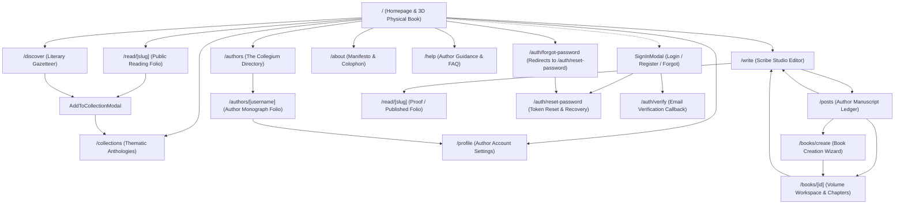
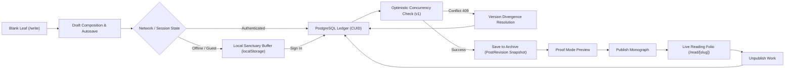
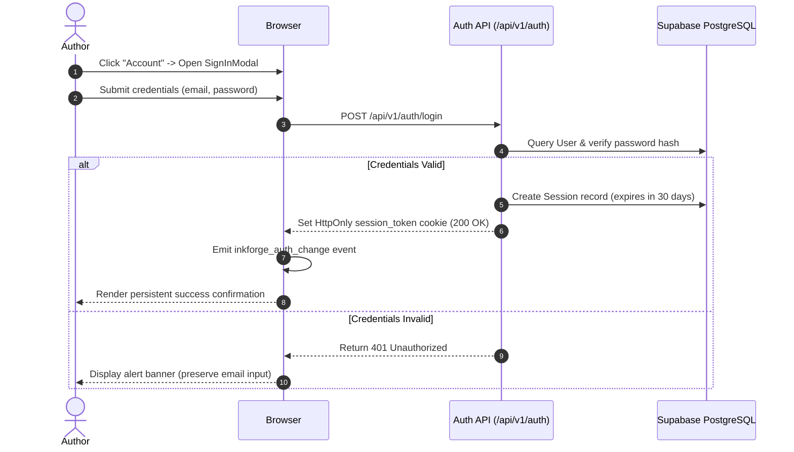
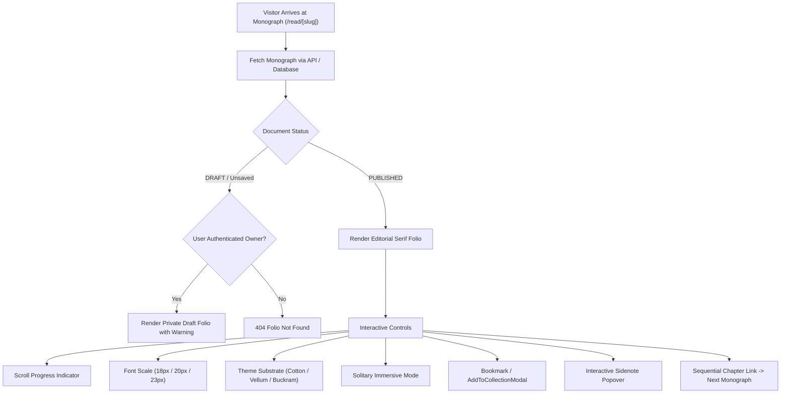
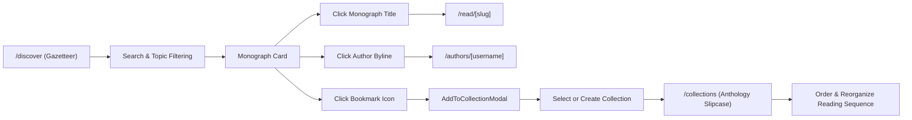

# INKFORGE — Page Inventory & Navigation Handbook

This document provides a complete, code-grounded catalog of all **17 App Router pages**, **27 API routes**, interactive overlay dialogs, and every navigation element, button, and menu option throughout INKFORGE.

---

## 1. Complete Application Navigation Diagrams

### Diagram 1: Full Application Navigation

---

### Diagram 2: Manuscript Lifecycle Flow

---

### Diagram 3: Authentication, Session & Access Control

---

### Diagram 4: Public Reader Journey

---

### Diagram 5: Discover, Collections & Author Curation

---

## 2. Exhaustive Route Inventory (17 App Router Routes)

### 1. Homepage
- **Exact Route:** `/`
- **Component File:** [`src/app/page.tsx`](file:///Users/kingpin/Documents/Vibecoded%20projects/inkforge/src/app/page.tsx)
- **Purpose:** Primary brand landing page, interactive 3D Physical Book showcase, curated autumn anthology, gazetteer dispatches, and colophon.
- **Access Level:** Public.
- **Entry Points:** Browser root URL, brand logo in navigation header, breadcrumb links.
- **Main Content:**
  - `Header`: Navigation hub with brand logo, primary links, paper theme selector, account trigger, and mobile menu.
  - `PhysicalBook`: Interactive 3D volume on stage with cover turning, Table of Contents, colophon, and touch gestures.
  - Autumn Anthology Lead Monograph card (*Crafting Systems That Endure*).
  - Gazetteer Dispatches sidebar (*On the Permanence of the Relational Calculus*).
  - Curated Contemporary Anthology 3-card grid with cascading scroll reveals.
  - Thematic Slipcase boxsets grid (4 volumes).
  - Scribe Ledger metrics panel (registered authors, words preserved, archival uptime).
  - Editorial Colophon footer.
- **Interactive Controls:**
  - *3D Book Cover:* Click or press `Enter` to unfold; swipe left/right on mobile.
  - *Table of Contents Items (6 chapters):* Deep-links to Read, Discover, Write, Collections, Authors, and About.
  - *Theme Selector:* Toggles Cotton Ivory, Bookshop Vellum, and Midnight Buckram.
  - *Account Button:* Launches `SignInModal`.
- **Data Operations:** Static and server-rendered data; loads current session via `GET /api/v1/auth/me`.
- **States:** Instant initial render with GPU scroll observers (`useScrollReveal`).
- **Mobile Behavior:** 3D book scales to screen width ($340\text{px}$–$390\text{px}$); touch swipe gestures enabled; hamburger drawer houses navigation links.
- **Verification Status:** Verified in production at `https://inkforge-sigma.vercel.app/`.

---

### 2. Public Reading Folio
- **Exact Route:** `/read/[slug]` (e.g., `/read/crafting-systems-that-endure`)
- **Component File:** [`src/app/(reader)/read/[slug]/page.tsx`](file:///Users/kingpin/Documents/Vibecoded%20projects/inkforge/src/app/%28reader%29/read/%5Bslug%5D/page.tsx)
- **Purpose:** Typography-first reading experience for published essays and treatises.
- **Access Level:** Public for published monographs; author-only for private drafts.
- **Entry Points:** Homepage Lead Story, Chapter I in Table of Contents, Discover cards, Collection items, Author bibliography.
- **Main Content:**
  - Monograph masthead: Issue, folio number, title, subtitle, author avatar, reading time estimate, date.
  - Body text formatted with drop caps, pullquotes, code snippets, and footnotes.
  - Footnote popovers with scholarly citations.
  - Next Chapter sequential recommendation banner.
- **Interactive Controls:**
  - *Reading Progress Ribbon:* Visual indicator tracking scroll position.
  - *Font Scale Selector:* Toggles 18px (Standard), 20px (Large), 23px (Generous).
  - *Theme Selector:* Toggles paper substrates.
  - *Solitary Mode:* Maximizes canvas and hides header.
  - *Add to Collection (Bookmark):* Opens `AddToCollectionModal`.
  - *Share Folio:* Copies canonical URL to clipboard.
  - *Footnote Indicators `[n]`:* Opens context sidenote card.
  - *Return to Catalog:* Navigates back to `/discover`.
- **Data Operations:** Fetches dynamic document via `GET /api/v1/documents/by-slug/:slug` with fallback to static curated monographs.
- **States:** Loading skeleton $\rightarrow$ Rendered folio $\rightarrow$ 404 Folio Not Found for invalid slugs.
- **Mobile Behavior:** Full-width text with $16\text{px}$ gutter padding; top progress bar persists during scroll.
- **Verification Status:** Verified in production.

---

### 3. Scribe Studio Editor
- **Exact Route:** `/write` (optional query parameters: `?id=[postId]`, `?bookId=[bookId]`)
- **Component File:** [`src/app/(studio)/write/page.tsx`](file:///Users/kingpin/Documents/Vibecoded%20projects/inkforge/src/app/%28studio%29/write/page.tsx)
- **Purpose:** Full-featured long-form composition desk, AST block editor, autosave manager, and publishing control center.
- **Access Level:** Guest authoring supported via local buffer; authenticated sync to PostgreSQL.
- **Entry Points:** Header "Write" link, Chapter III in Table of Contents, "/posts" "Edit Manuscript" button.
- **Main Content:**
  - Title and subtitle inputs.
  - Tiptap block editor canvas with 6-group editorial formatting toolbar.
  - Bottom metrics strip: word count, character count, reading time, rhythm classifier, autosave indicator.
  - Action bar: Save, Revisions, Proof Mode, Solitary Focus Mode, AI Copilot, Publish/Unpublish.
- **Interactive Controls:**
  - *Formatting Toolbar Buttons:* H1, H2, H3, Bold, Italic, Underline, Strike, Code, Highlight, Clear Formatting, Bullet List, Numbered List, Pullquote, Code Block, Horizontal Rule, Insert Popover (Link, Image, Table).
  - *Font Family & Scale Dropdowns:* Switches typography across editor canvas.
  - *Autosave & Save Button (`Cmd+S`):* Manually saves changes to database.
  - *Revisions Button:* Opens historical snapshot drawer.
  - *AI Copilot Button (`Cmd+J`):* Opens AI assistant drawer.
  - *Proof Mode Toggle:* Renders public preview via `SafeContentRenderer`.
  - *Publish Button:* Publishes document and launches `PublishModal`.
  - *Version Conflict Bar:* Appears on 409 conflict with resolve buttons.
- **Data Operations:**
  - Debounced auto-save via `POST /api/v1/documents` or `PATCH /api/v1/documents/:id`.
  - Version incrementing with optimistic locking.
  - Local caching via `DraftManager`.
- **States:** Initializing $\rightarrow$ Dirty (Unsaved) $\rightarrow$ Saving $\rightarrow$ Saved $\rightarrow$ Conflict (409) $\rightarrow$ Offline Saved.
- **Mobile Behavior:** Toolbar scrolls horizontally with touch friction; bottom bar stacks vertically.
- **Verification Status:** Verified in production.

---

### 4. Author Manuscript Ledger
- **Exact Route:** `/posts`
- **Component File:** [`src/app/(studio)/posts/page.tsx`](file:///Users/kingpin/Documents/Vibecoded%20projects/inkforge/src/app/%28studio%29/posts/page.tsx)
- **Purpose:** Personal manuscript archive, draft ledger, and volume management dashboard.
- **Access Level:** Authenticated author (or local guest session).
- **Entry Points:** Header user menu "My Drafts & Ledger", mobile drawer, `/write` breadcrumbs.
- **Main Content:**
  - Filter tabs: `ALL`, `DRAFT`, `IN_REVIEW`, `SCHEDULED`, `PUBLISHED`.
  - Manuscript cards with status badges, version numbers, word counts, and timestamps.
  - Volumes & Slipcases section.
  - Local drafts migration banner (if unmigrated drafts detected).
- **Interactive Controls:**
  - *Tab Switchers:* Filters active manuscripts by status.
  - *Create New Monograph:* Navigates to `/write`.
  - *Create Volume Slipcase:* Navigates to `/books/create`.
  - *Edit Manuscript Button:* Navigates to `/write?id=[id]`.
  - *Open Public Monograph:* Navigates to `/read/[slug]`.
  - *Delete Manuscript Button:* Prompts for confirmation and deletes document.
  - *Sync Local Drafts Button:* Migrates local drafts to server.
- **Data Operations:** `GET /api/v1/documents` fetches user's documents; `DELETE /api/v1/documents/:id` deletes a document.
- **States:** Loading spinner $\rightarrow$ Populated grid $\rightarrow$ Empty state with "Write First Monograph" call-to-action.
- **Mobile Behavior:** Single-column card stack with touch buttons.
- **Verification Status:** Verified in production.

---

### 5. Literary Gazetteer (Discover)
- **Exact Route:** `/discover`
- **Component File:** [`src/app/discover/page.tsx`](file:///Users/kingpin/Documents/Vibecoded%20projects/inkforge/src/app/discover/page.tsx)
- **Purpose:** Searchable catalog and thematic exploration hub for all published monographs.
- **Access Level:** Public.
- **Entry Points:** Header "Discover" link, Chapter II in Table of Contents, footer links.
- **Main Content:**
  - Live search bar with clear button.
  - Topic filter chips: `ALL`, `SYSTEMS CRAFT`, `LITERARY ECOLOGY`, `DIGITAL THEORY`.
  - Reading time filter slider / dropdown.
  - Grid of monograph cards with category kickers, reading times, titles, excerpts, and author bylines.
  - Pagination controls.
- **Interactive Controls:**
  - *Search Input:* Real-time debounced query filtering.
  - *Topic Chips:* Filters cards by thematic category.
  - *Bookmark Button:* Opens `AddToCollectionModal`.
  - *Author Byline Link:* Navigates to `/authors/[username]`.
  - *Monograph Card Title:* Navigates to `/read/[slug]`.
  - *Previous / Next Page:* Navigates between result pages.
- **Data Operations:** `GET /api/v1/documents` with search and pagination parameters.
- **States:** Loading state $\rightarrow$ Filtered catalog $\rightarrow$ Empty search state (*"No monographs found matching query"*).
- **Mobile Behavior:** Search and filter chips wrap into a touchable row; cards display full width.
- **Verification Status:** Verified in production.

---

### 6. Thematic Collections (Anthologies)
- **Exact Route:** `/collections`
- **Component File:** [`src/app/collections/page.tsx`](file:///Users/kingpin/Documents/Vibecoded%20projects/inkforge/src/app/collections/page.tsx)
- **Purpose:** Curated anthologies, slipcase volumes, and personal reading lists.
- **Access Level:** Public viewing for public collections; authenticated for private folios and curation.
- **Entry Points:** Header "Collections" link, Chapter IV in Table of Contents, discover cards.
- **Main Content:**
  - Tab switcher: `Public Anthologies` vs `My Private Folios`.
  - Left sidebar: List of collection volumes with item counts and owner tags.
  - Right pane: Active collection details, description, ordered story items, and action bar.
- **Interactive Controls:**
  - *New Collection Button:* Opens `CreateCollectionModal`.
  - *Edit Collection Button:* Opens `EditCollectionModal` (title, description, visibility).
  - *Delete Collection Button:* Deletes collection record.
  - *Remove Item Button:* Deletes association between story and collection.
  - *Story Card Link:* Navigates to `/read/[slug]`.
- **Data Operations:**
  - `GET /api/v1/collections` fetches list.
  - `GET /api/v1/collections/:id` fetches active collection details.
  - `POST /api/v1/collections` creates collection.
  - `PATCH /api/v1/collections/:id` updates metadata.
  - `DELETE /api/v1/collections/:id` deletes collection.
- **States:** Loading spinner $\rightarrow$ Split-view display $\rightarrow$ Empty state with "Create First Anthology".
- **Mobile Behavior:** Replaces split-view with stacked view (collection picker accordion above details pane).
- **Verification Status:** Verified in production.

---

### 7. Resident Authors Directory (The Collegium)
- **Exact Route:** `/authors`
- **Component File:** [`src/app/authors/page.tsx`](file:///Users/kingpin/Documents/Vibecoded%20projects/inkforge/src/app/authors/page.tsx)
- **Purpose:** Public directory of registered authors and founding fellows.
- **Access Level:** Public.
- **Entry Points:** Header "Authors" link, Chapter V in Table of Contents, footer links.
- **Main Content:**
  - Masthead explaining the INKFORGE editorial fellowship.
  - Registered Authors live directory fetched from database.
  - Founding Fellows biographical cards with affiliations and featured monographs.
- **Interactive Controls:**
  - *Author Card Link:* Navigates to `/authors/[username]`.
  - *Featured Story Link:* Navigates to `/read/[slug]`.
  - *Inscribe Folio CTA:* Opens `SignInModal` in registration mode.
- **Data Operations:** `GET /api/v1/authors` queries all users with published works.
- **States:** Loading pulse $\rightarrow$ Grid of fellows $\rightarrow$ Fallback to founding fellows if database empty.
- **Mobile Behavior:** Single-column responsive card layout.
- **Verification Status:** Verified in production.

---

### 8. Individual Author Monograph Folio
- **Exact Route:** `/authors/[username]` (e.g., `/authors/elena-rostova`)
- **Component File:** [`src/app/authors/[username]/page.tsx`](file:///Users/kingpin/Documents/Vibecoded%20projects/inkforge/src/app/authors/%5Busername%5D/page.tsx)
- **Purpose:** Public profile, biography, and published works for an individual author.
- **Access Level:** Public.
- **Entry Points:** Author bylines across `/read/[slug]`, `/discover`, `/authors`, and user menu.
- **Main Content:**
  - Author identity banner: Avatar initial circle, display name, handle, role, location, website link.
  - Author biography card.
  - Full bibliography list of published monographs with reading times and dates.
- **Interactive Controls:**
  - *Edit Author Profile Button:* Visible only when viewing user is the author; links to `/profile`.
  - *Monograph Links:* Direct links to `/read/[slug]`.
  - *External Website Link:* Opens author's external URL in new tab.
- **Data Operations:** `GET /api/v1/authors/:username` fetches author metadata and published posts.
- **States:** Loading skeleton $\rightarrow$ Populated folio $\rightarrow$ 404 Author Not Found.
- **Mobile Behavior:** Centered author banner with stacked monographs.
- **Verification Status:** Verified in production.

---

### 9. Author Profile Settings
- **Exact Route:** `/profile`
- **Component File:** [`src/app/profile/page.tsx`](file:///Users/kingpin/Documents/Vibecoded%20projects/inkforge/src/app/profile/page.tsx)
- **Purpose:** Authenticated settings page to manage author profile credentials, bio, and public links.
- **Access Level:** Authenticated.
- **Entry Points:** Header user menu "Edit Author Profile", mobile drawer, author folio shortcut.
- **Main Content:** Form fields for Display Name, Username, Biography, Location, and Website URL.
- **Interactive Controls:**
  - *Form Inputs:* Text inputs for profile attributes.
  - *Save Profile Button:* Issues update request with animated loading feedback.
  - *View Public Profile Link:* Navigates to `/authors/[username]`.
- **Data Operations:**
  - `GET /api/v1/auth/me` populates initial form data.
  - `PATCH /api/v1/auth/me` updates user record and profile.
- **States:** Loading $\rightarrow$ Editable form $\rightarrow$ Success toast $\rightarrow$ Unauthenticated prompt (launches `SignInModal`).
- **Mobile Behavior:** Full-width form controls with $\ge 44\text{px}$ touch targets.
- **Verification Status:** Verified in production.

---

### 10. Book Creation Wizard
- **Exact Route:** `/books/create`
- **Component File:** [`src/app/books/create/page.tsx`](file:///Users/kingpin/Documents/Vibecoded%20projects/inkforge/src/app/books/create/page.tsx)
- **Purpose:** 3-step creation wizard for assembling complete book volumes with AI-assisted cover design.
- **Access Level:** Public / Authenticated.
- **Entry Points:** `/posts` "Create Volume Slipcase" button, book viewer navigation.
- **Main Content:**
  - Step 1: Volume Identity (Title, Subtitle, Author, Genre preset, Mood preset, Keywords, Direction).
  - Step 2: AI Visual Brief Interpretation (calls `/api/covers/interpret`, displays symbolic motifs, concepts).
  - Step 3: Cover Studio (3D PhysicalBook preview vs Flat, foil stamping styles, AI cover generation via `/api/covers/generate`).
- **Interactive Controls:**
  - *Step Navigation Buttons:* Back and Next step transitions.
  - *Generate Concepts Button:* Dispatches interpretation request.
  - *Select Concept Card:* Highlights chosen design direction.
  - *Generate Artwork Button:* Calls cover generation engine.
  - *Save Volume Button:* Commits book record to storage and navigates to `/books/[id]`.
- **Data Operations:** Calls `/api/covers/interpret`, `/api/covers/generate`, and `saveBook()`.
- **States:** Step 1 $\rightarrow$ Step 2 (Interpreting...) $\rightarrow$ Step 3 (Studio Preview).
- **Mobile Behavior:** Step indicators collapse into compact numeric dots; preview toggles adapt to mobile screen.
- **Verification Status:** Verified in production.

---

### 11. Book Volume Workspace & Reader
- **Exact Route:** `/books/[id]` (e.g., `/books/book_1`)
- **Component File:** [`src/app/books/[id]/page.tsx`](file:///Users/kingpin/Documents/Vibecoded%20projects/inkforge/src/app/books/%5Bid%5D/page.tsx)
- **Purpose:** Dedicated volume workspace for inspecting cover versions, outlines, and chapter manuscripts.
- **Access Level:** Public viewing; author-owned editing.
- **Entry Points:** `/posts` volume cards, `/books/create` completion.
- **Main Content:**
  - Interactive 3D PhysicalBook rendering the book's custom cover artwork and typography.
  - Side control panel with Chapter Outline, Editorial Notes, and Cover Version switcher.
  - Action buttons: "Write in Scribe Studio", "Preview Public Monograph".
- **Interactive Controls:**
  - *PhysicalBook:* Click to unfold and inspect internal pages.
  - *View Mode Toggle:* Switches between 3D Book view and Flat Cover view.
  - *Panel Tabs:* Outline, Notes, Cover versions.
  - *Write Chapter Button:* Navigates to `/write?bookId=[bookId]`.
  - *Regenerate Cover Button:* Triggers cover redesign pipeline.
- **Data Operations:** Reads volume from `lib/book-store` by ID.
- **States:** Populated volume workspace $\rightarrow$ 404 Volume Not Found with return link.
- **Mobile Behavior:** 3D book scales to mobile dimensions; side panels collapse below the book stage.
- **Verification Status:** Verified in production.

---

### 12. Editorial Manifesto & About
- **Exact Route:** `/about`
- **Component File:** [`src/app/about/page.tsx`](file:///Users/kingpin/Documents/Vibecoded%20projects/inkforge/src/app/about/page.tsx)
- **Purpose:** Editorial philosophy, colophon credits, platform mission, and typographic rationale.
- **Access Level:** Public.
- **Entry Points:** Header "About" link, Chapter VI in Table of Contents, footer links.
- **Main Content:**
  - Colophon masthead with `.scroll-ink-reveal` animation.
  - Core essays on permanence, block composition, and the independent web.
  - Digital typeset specifications (Newsreader, EB Garamond, JetBrains Mono).
  - Open invitation callout with link to Scribe Studio.
- **Interactive Controls:**
  - *Navigation Links:* Return home, enter studio (`/write`), browse catalogue (`/discover`).
- **Data Operations:** Static content with GPU scroll reveal observers.
- **States:** Complete instant render.
- **Mobile Behavior:** Editorial single-column layout with generous paragraph leading.
- **Verification Status:** Verified in production.

---

### 13. Platform Guide & Help
- **Exact Route:** `/help`
- **Component File:** [`src/app/help/page.tsx`](file:///Users/kingpin/Documents/Vibecoded%20projects/inkforge/src/app/help/page.tsx)
- **Purpose:** Interactive FAQ, user onboarding manual, and support resource.
- **Access Level:** Public.
- **Entry Points:** Header "Help" link, mobile drawer, footer links.
- **Main Content:**
  - Categorized FAQ accordions: *Getting Started*, *Reading Experience*, *Writing & Scribe Studio*, *Account & Security*.
  - Searchable question list.
  - Direct quick-link action buttons to `/write`, `/read`, and `/discover`.
- **Interactive Controls:**
  - *Accordion Items:* Click question to expand/collapse answer with animated chevron.
  - *Category Filter Buttons:* Filters questions by functional area.
- **Data Operations:** Client-side state filtering.
- **States:** Complete instant render.
- **Mobile Behavior:** Tap-friendly accordions with $\ge 44\text{px}$ touch targets.
- **Verification Status:** Verified in production.

---

### 14. Password Reset Form & Recovery
- **Exact Route:** `/auth/reset-password` (optional query: `?token=[token]`)
- **Component File:** [`src/app/auth/reset-password/page.tsx`](file:///Users/kingpin/Documents/Vibecoded%20projects/inkforge/src/app/auth/reset-password/page.tsx)
- **Purpose:** Single-use password reset verification and new password form.
- **Access Level:** Public.
- **Entry Points:** Password reset email links, canonical redirect from `/auth/forgot-password`.
- **Main Content:**
  - State A (Token Provided): Password input, confirmation input, show/hide password toggle, submit button.
  - State B (No Token / Expired): Recovery link request form with email input.
- **Interactive Controls:**
  - *Password Inputs:* Minimum 8 characters with live validation.
  - *Update Password Button:* Submits `POST /api/v1/auth/reset-password`.
  - *Request New Link Button:* Submits `POST /api/v1/auth/forgot-password`.
- **Data Operations:**
  - Validates token on mount via `GET /api/v1/auth/reset-password?token=...`.
  - Updates password via `POST /api/v1/auth/reset-password`.
- **States:** Validating $\rightarrow$ Active Form $\rightarrow$ Success Screen with direct "Sign In" button $\rightarrow$ Error (Expired/Invalid Token).
- **Mobile Behavior:** Responsive centered form card.
- **Verification Status:** Verified in production.

---

### 15. Password Forgot Redirect
- **Exact Route:** `/auth/forgot-password`
- **Component File:** [`src/app/auth/forgot-password/page.tsx`](file:///Users/kingpin/Documents/Vibecoded%20projects/inkforge/src/app/auth/forgot-password/page.tsx)
- **Purpose:** Canonical redirect route ensuring external links or legacy bookmarks redirect cleanly to `/auth/reset-password` without 404 errors.
- **Access Level:** Public.
- **Behavior:** Executes Next.js server-side `redirect("/auth/reset-password")`.
- **Verification Status:** Verified in production.

---

### 16. Email Verification Callback
- **Exact Route:** `/auth/verify` (query parameter: `?token=[token]`)
- **Component File:** [`src/app/auth/verify/page.tsx`](file:///Users/kingpin/Documents/Vibecoded%20projects/inkforge/src/app/auth/verify/page.tsx)
- **Purpose:** Verification endpoint confirming author email addresses and activating the "Verified Imprint" status.
- **Access Level:** Public.
- **Entry Points:** Verification email links.
- **Main Content:** Token validation loader, success celebration banner, or expired token recovery form.
- **Interactive Controls:**
  - *Continue to Sanctuary Button:* Navigates to `/write` upon success.
  - *Resend Verification Link Form:* Input and submit button to dispatch fresh token.
- **Data Operations:** Submits `POST /api/v1/auth/verify-email` with token payload.
- **States:** Verifying Token $\rightarrow$ Success Confirmed $\rightarrow$ Invalid/Expired Token.
- **Mobile Behavior:** Centered celebration card.
- **Verification Status:** Verified in production.

---

### 17. Custom 404 Error Folio
- **Exact Route:** `/_not-found` (rendered for any unmapped URL)
- **Component File:** `src/app/not-found.tsx`
- **Purpose:** Editorial-styled 404 error page maintaining platform aesthetic.
- **Access Level:** Public.
- **Main Content:** Archival illustration, *"Folio Not Found in Registry"*, explanation, and return shortcuts.
- **Interactive Controls:**
  - *Return to Homepage Button:* Navigates to `/`.
  - *Explore Catalogue Button:* Navigates to `/discover`.
- **Verification Status:** Verified in production.

---

## 3. Exhaustive Menu & Navigation Option Inventory

Below is an exhaustive inventory of every individual navigation link, menu item, toolbar button, and interactive trigger across INKFORGE, structured according to the required specification.

### 1. Brand Wordmark ("INKFORGE")
- **Location:** Header top-left on all pages.
- **Purpose:** Returns the user to the application homepage root.
- **What the user sees:** Large serif wordmark "INKFORGE" with small monospaced subtitle *"Write • Publish • Discover • Read"*.
- **Action:** Navigates to `/`.
- **Navigation destination:** `/`
- **Backend behavior:** None (Client-side Next.js route transition).
- **Access requirements:** None (Public).
- **Expected result:** Immediate transition to homepage.
- **Failure behavior:** None.
- **Verification status:** Verified.

### 2. Primary Navigation: "Read"
- **Location:** Header primary nav group.
- **Purpose:** Deep-links directly to the flagship published monograph.
- **What the user sees:** BookOpen icon with label "Read", highlighted in oxblood when on reading routes.
- **Action:** Navigates to `/read/crafting-systems-that-endure`.
- **Navigation destination:** `/read/crafting-systems-that-endure`
- **Backend behavior:** SSR page fetch for monograph route.
- **Access requirements:** None (Public).
- **Expected result:** Opens flagship reading folio with scroll progress ribbon.
- **Failure behavior:** Fallback to static text if database offline.
- **Verification status:** Verified.

### 3. Primary Navigation: "Discover"
- **Location:** Header primary nav group.
- **Purpose:** Opens the searchable literary gazetteer.
- **What the user sees:** Compass icon with label "Discover".
- **Action:** Navigates to `/discover`.
- **Navigation destination:** `/discover`
- **Backend behavior:** Fetches document catalog via `GET /api/v1/documents`.
- **Access requirements:** None (Public).
- **Expected result:** Opens gazetteer with search bar and topic filters.
- **Failure behavior:** Renders static curated monographs if API fails.
- **Verification status:** Verified.

### 4. Primary Navigation: "Write"
- **Location:** Header primary nav group.
- **Purpose:** Opens the Scribe Studio composition desk.
- **What the user sees:** PenTool icon with label "Write".
- **Action:** Navigates to `/write`.
- **Navigation destination:** `/write`
- **Backend behavior:** Initializes editor with local-first draft or loads active manuscript.
- **Access requirements:** None (Guest authoring supported; authenticated sync).
- **Expected result:** Full-screen Scribe Studio canvas opens.
- **Failure behavior:** Buffers unsaved prose locally if network unreachable.
- **Verification status:** Verified.

### 5. Secondary Navigation: "Collections"
- **Location:** Header secondary nav group.
- **Purpose:** Opens the curated slipcase anthologies and reading lists.
- **What the user sees:** Layers icon with label "Collections".
- **Action:** Navigates to `/collections`.
- **Navigation destination:** `/collections`
- **Backend behavior:** Fetches public and personal collections via `GET /api/v1/collections`.
- **Access requirements:** None (Public viewing; authenticated curation).
- **Expected result:** Opens collections explorer with active anthology details.
- **Failure behavior:** Displays empty state if no collections created.
- **Verification status:** Verified.

### 6. Secondary Navigation: "Authors"
- **Location:** Header secondary nav group.
- **Purpose:** Opens the directory of registered authors and founding fellows.
- **What the user sees:** Users icon with label "Authors".
- **Action:** Navigates to `/authors`.
- **Navigation destination:** `/authors`
- **Backend behavior:** Queries author registry via `GET /api/v1/authors`.
- **Access requirements:** None (Public).
- **Expected result:** Opens directory of resident fellows and registered authors.
- **Failure behavior:** Falls back to founding fellows list if database empty.
- **Verification status:** Verified.

### 7. Utility Navigation: "About"
- **Location:** Header right utility area (desktop lg+).
- **Purpose:** Opens the manifesto and colophon.
- **What the user sees:** Monospaced link "About".
- **Action:** Navigates to `/about`.
- **Navigation destination:** `/about`
- **Backend behavior:** None.
- **Access requirements:** None (Public).
- **Expected result:** Renders publishing manifesto and typographic specs.
- **Failure behavior:** None.
- **Verification status:** Verified.

### 8. Utility Navigation: "Help"
- **Location:** Header right utility area (desktop lg+).
- **Purpose:** Opens the platform FAQ and guidance manual.
- **What the user sees:** Monospaced link "Help".
- **Action:** Navigates to `/help`.
- **Navigation destination:** `/help`
- **Backend behavior:** None.
- **Access requirements:** None (Public).
- **Expected result:** Renders categorized FAQ accordions.
- **Failure behavior:** None.
- **Verification status:** Verified.

### 9. Reading Theme Selector Trigger
- **Location:** Header right utility area on all pages.
- **Purpose:** Opens the paper substrate selection dropdown.
- **What the user sees:** Palette icon, "Theme" label, active color swatch dot, chevron arrow (height $32\text{px}$).
- **Action:** Toggles dropdown menu containing Cotton Ivory, Bookshop Vellum, and Midnight Buckram.
- **Navigation destination:** Local state / DOM update (no route change).
- **Backend behavior:** None; updates `localStorage` key `inkforge_paper_tone`.
- **Access requirements:** None (Public).
- **Expected result:** Opens accessible dropdown with keyboard navigation.
- **Failure behavior:** Defaults to Cotton Ivory if storage disabled.
- **Verification status:** Verified.

### 10. Account Button (Logged Out)
- **Location:** Header right utility area (when not authenticated).
- **Purpose:** Opens the authentication and sign-in modal.
- **What the user sees:** User icon with label "Account" (height $32\text{px}$).
- **Action:** Sets `signInOpen = true` in `Header.tsx`.
- **Navigation destination:** Opens `SignInModal` dialog.
- **Backend behavior:** None on click.
- **Access requirements:** None (Public).
- **Expected result:** `SignInModal` dialog renders centered on screen with backdrop blur.
- **Failure behavior:** None.
- **Verification status:** Verified.

### 11. User Profile Menu Trigger (Logged In)
- **Location:** Header right utility area (when authenticated).
- **Purpose:** Opens the author's personal workspace dropdown menu.
- **What the user sees:** Circular avatar with initial, display name, and chevron arrow.
- **Action:** Toggles author dropdown menu.
- **Navigation destination:** Local dropdown.
- **Backend behavior:** None on toggle.
- **Access requirements:** Authenticated session.
- **Expected result:** Opens dropdown displaying email, verified badge, and navigation shortcuts.
- **Failure behavior:** Auto-closes on outside click or `Escape` key.
- **Verification status:** Verified.

### 12. User Menu Option: "My Public Profile"
- **Location:** Inside Header user menu dropdown.
- **Purpose:** Navigates to the author's public folio page.
- **What the user sees:** User icon with label "My Public Profile".
- **Action:** Navigates to `/authors/[username]`.
- **Navigation destination:** `/authors/[username]`
- **Backend behavior:** Fetches user's public folio.
- **Access requirements:** Authenticated session.
- **Expected result:** Opens author's public profile and bibliography.
- **Failure behavior:** None.
- **Verification status:** Verified.

### 13. User Menu Option: "Edit Author Profile"
- **Location:** Inside Header user menu dropdown.
- **Purpose:** Navigates to profile settings to update bio, location, and website.
- **What the user sees:** Edit3 icon with label "Edit Author Profile".
- **Action:** Navigates to `/profile`.
- **Navigation destination:** `/profile`
- **Backend behavior:** Loads profile data via `GET /api/v1/auth/me`.
- **Access requirements:** Authenticated session.
- **Expected result:** Opens profile editing form.
- **Failure behavior:** Redirects to login if session expired.
- **Verification status:** Verified.

### 14. User Menu Option: "My Drafts & Ledger"
- **Location:** Inside Header user menu dropdown.
- **Purpose:** Opens the manuscript dashboard and drafting ledger.
- **What the user sees:** FileText icon with label "My Drafts & Ledger".
- **Action:** Navigates to `/posts`.
- **Navigation destination:** `/posts`
- **Backend behavior:** Queries documents via `GET /api/v1/documents`.
- **Access requirements:** Authenticated session.
- **Expected result:** Opens dashboard with document status tabs.
- **Failure behavior:** None.
- **Verification status:** Verified.

### 15. User Menu Option: "Write New Piece"
- **Location:** Inside Header user menu dropdown.
- **Purpose:** Opens a blank canvas in Scribe Studio.
- **What the user sees:** PenTool icon with label "Write New Piece".
- **Action:** Navigates to `/write`.
- **Navigation destination:** `/write`
- **Backend behavior:** None.
- **Access requirements:** Authenticated session.
- **Expected result:** Opens clean Scribe Studio leaf.
- **Failure behavior:** Prompts if current document has unsaved edits.
- **Verification status:** Verified.

### 16. User Menu Option: "Sign Out"
- **Location:** Inside Header user menu dropdown (bottom divider).
- **Purpose:** Terminates the active session and logs out the author.
- **What the user sees:** LogOut icon with label "Sign Out" in red accent.
- **Action:** Calls `handleLogout()`.
- **Navigation destination:** Stays on current page; updates header to logged-out state.
- **Backend behavior:** Issues `POST /api/v1/auth/logout`, revokes DB session, and clears `session_token` cookie.
- **Access requirements:** Authenticated session.
- **Expected result:** Session revoked; header updates to display "Account" button.
- **Failure behavior:** Force-clears local state even if network call fails.
- **Verification status:** Verified.

### 17. User Menu Button: "Resend Link" (Verification)
- **Location:** Inside Header user menu dropdown under unverified warning.
- **Purpose:** Dispatches a new email verification token.
- **What the user sees:** Underlined text "Resend Link" (or countdown timer e.g., "54s").
- **Action:** Calls `handleResendVerification()`.
- **Navigation destination:** None (in-dropdown action).
- **Backend behavior:** Issues `POST /api/v1/auth/resend-verification`.
- **Access requirements:** Authenticated unverified author.
- **Expected result:** Shows confirmation message and initiates 60-second cooldown timer.
- **Failure behavior:** Displays error message if rate limit or network fails.
- **Verification status:** Verified.

### 18. Mobile Menu Hamburger Button
- **Location:** Header right corner (visible on viewports $< 768\text{px}$).
- **Purpose:** Toggles the mobile navigation slide-down drawer.
- **What the user sees:** Menu icon ($44\times 44\text{px}$ touch target), transitions to X icon when open.
- **Action:** Toggles `mobileMenuOpen` state in `Header.tsx`.
- **Navigation destination:** None (DOM drawer reveal).
- **Backend behavior:** None.
- **Access requirements:** None (Public).
- **Expected result:** Opens mobile drawer displaying categorized destinations.
- **Failure behavior:** None.
- **Verification status:** Verified.

### 19. Mobile Drawer: "Editorial Ledger & Drafts"
- **Location:** Inside Mobile navigation drawer under Primary Destinations.
- **Purpose:** Quick-navigates to the author's drafts dashboard.
- **What the user sees:** FileText icon with label "Editorial Ledger & Drafts".
- **Action:** Navigates to `/posts` and closes mobile drawer.
- **Navigation destination:** `/posts`
- **Backend behavior:** Queries user documents.
- **Access requirements:** Authenticated or local session.
- **Expected result:** Opens manuscript dashboard.
- **Failure behavior:** None.
- **Verification status:** Verified.

### 20. 3D Physical Book Cover Trigger
- **Location:** Homepage center desk stage (`/`).
- **Purpose:** Unfolds the 3D book volume to reveal the Table of Contents and Colophon.
- **What the user sees:** Archival buckram cover with gold-foil crest, title, and bookplate *"Unfold Volume • Open"*.
- **Action:** Toggles `isOpen` state in `PhysicalBook.tsx`.
- **Navigation destination:** None (3D physical animation).
- **Backend behavior:** None.
- **Access requirements:** None (Public).
- **Expected result:** Cover lifts from stage (`translateZ(28px)`) and unfolds 180 degrees along spine.
- **Failure behavior:** Instantaneous unfold without rotation if reduced motion preferred.
- **Verification status:** Verified.

### 21. Table of Contents: Chapter I ("Read: The Lead Monograph")
- **Location:** Inside unfolded 3D book right folio.
- **Purpose:** Navigates directly to the lead published essay.
- **What the user sees:** BookOpen icon, "I.", title, and reading time badge "6 min read".
- **Action:** Navigates to `/read/crafting-systems-that-endure`.
- **Navigation destination:** `/read/crafting-systems-that-endure`
- **Backend behavior:** SSR route load.
- **Access requirements:** None (Public).
- **Expected result:** Opens reading folio.
- **Failure behavior:** None.
- **Verification status:** Verified.

### 22. Table of Contents: Chapter II ("Discover: Stories & Catalog")
- **Location:** Inside unfolded 3D book right folio.
- **Purpose:** Navigates to the gazetteer.
- **What the user sees:** Compass icon, "II.", title, and "Catalog" badge.
- **Action:** Navigates to `/discover`.
- **Navigation destination:** `/discover`
- **Backend behavior:** Loads catalog.
- **Access requirements:** None (Public).
- **Expected result:** Opens `/discover`.
- **Failure behavior:** None.
- **Verification status:** Verified.

### 23. Table of Contents: Chapter III ("Write: Scribe Studio Desk")
- **Location:** Inside unfolded 3D book right folio.
- **Purpose:** Navigates to the composition editor.
- **What the user sees:** PenTool icon, "III.", title, and "Studio" badge.
- **Action:** Navigates to `/write`.
- **Navigation destination:** `/write`
- **Backend behavior:** Initializes editor.
- **Access requirements:** None (Public).
- **Expected result:** Opens `/write`.
- **Failure behavior:** None.
- **Verification status:** Verified.

### 24. Table of Contents: Chapter IV ("Collections: Thematic Folios")
- **Location:** Inside unfolded 3D book right folio.
- **Purpose:** Navigates to the anthologies page.
- **What the user sees:** Layers icon, "IV.", title, and "4 Volumes" badge.
- **Action:** Navigates to `/collections`.
- **Navigation destination:** `/collections`
- **Backend behavior:** Fetches collections.
- **Access requirements:** None (Public).
- **Expected result:** Opens `/collections`.
- **Failure behavior:** None.
- **Verification status:** Verified.

### 25. Table of Contents: Chapter V ("Authors: The Collegium")
- **Location:** Inside unfolded 3D book right folio.
- **Purpose:** Navigates to the authors directory.
- **What the user sees:** Users icon, "V.", title, and "Fellows" badge.
- **Action:** Navigates to `/authors`.
- **Navigation destination:** `/authors`
- **Backend behavior:** Fetches author registry.
- **Access requirements:** None (Public).
- **Expected result:** Opens `/authors`.
- **Failure behavior:** None.
- **Verification status:** Verified.

### 26. Table of Contents: Chapter VI ("About: Manifesto & Colophon")
- **Location:** Inside unfolded 3D book right folio.
- **Purpose:** Navigates to the platform manifesto.
- **What the user sees:** BookMarked icon, "VI.", title, and "Colophon" badge.
- **Action:** Navigates to `/about`.
- **Navigation destination:** `/about`
- **Backend behavior:** None.
- **Access requirements:** None (Public).
- **Expected result:** Opens `/about`.
- **Failure behavior:** None.
- **Verification status:** Verified.

### 27. Scribe Studio: "Save" Button
- **Location:** Studio action bar at top-right of `/write`.
- **Purpose:** Manually flushes unsaved edits to the server.
- **What the user sees:** Save floppy icon with label "Save".
- **Action:** Calls `doc.manualSave()`.
- **Navigation destination:** Stays on `/write`.
- **Backend behavior:** Issues `POST /api/v1/documents` or `PATCH /api/v1/documents/:id`.
- **Access requirements:** Author ownership of document.
- **Expected result:** Updates status indicator to *"Archived (hh:mm:ss)"*.
- **Failure behavior:** Buffers in local storage if network fails.
- **Verification status:** Verified.

### 28. Scribe Studio: "Revisions" Button
- **Location:** Studio action bar on `/write`.
- **Purpose:** Slides open the historical revision drawer.
- **What the user sees:** History clock icon with label "Revisions".
- **Action:** Calls `handleOpenRevisions()`.
- **Navigation destination:** Opens right drawer.
- **Backend behavior:** Issues `GET /api/v1/documents/:id/revisions`.
- **Access requirements:** Document owner.
- **Expected result:** Drawer displays chronological snapshots with restore buttons.
- **Failure behavior:** Displays error toast if fetch fails.
- **Verification status:** Verified.

### 29. Scribe Studio: "AI Copilot" Button
- **Location:** Studio action bar on `/write` and Tiptap toolbar.
- **Purpose:** Opens the AI Writing Copilot sidebar panel.
- **What the user sees:** Sparkles icon with label "AI Copilot" in oxblood accent.
- **Action:** Toggles `aiCopilotOpen` state.
- **Navigation destination:** Opens sidebar panel.
- **Backend behavior:** None on open.
- **Access requirements:** Authenticated author.
- **Expected result:** AI assistant panel opens with 10 task options.
- **Failure behavior:** None.
- **Verification status:** Verified.

### 30. Scribe Studio: "Proof Mode" Toggle
- **Location:** Studio action bar on `/write`.
- **Purpose:** Previews the monograph formatted exactly as published in the reader.
- **What the user sees:** Eye icon with label "Proof Mode".
- **Action:** Toggles `proofMode` boolean.
- **Navigation destination:** In-canvas preview toggle.
- **Backend behavior:** None.
- **Access requirements:** None.
- **Expected result:** Swaps editor canvas with `SafeContentRenderer`.
- **Failure behavior:** None.
- **Verification status:** Verified.

### 31. Scribe Studio: "Focus Mode" Toggle
- **Location:** Studio action bar on `/write`.
- **Purpose:** Removes all distractions for solitary writing immersion.
- **What the user sees:** Maximize icon with label "Focus Mode".
- **Action:** Sets `focusMode = true`.
- **Navigation destination:** None (removes navigation header and sidebars).
- **Backend behavior:** None.
- **Access requirements:** None.
- **Expected result:** Header disappears; minimal floating status strip appears.
- **Failure behavior:** None.
- **Verification status:** Verified.

### 32. Scribe Studio: "Publish" Button
- **Location:** Studio action bar on `/write` (visible when document is draft).
- **Purpose:** Initiates the publishing ceremony.
- **What the user sees:** Send icon with label "Publish" in oxblood background.
- **Action:** Calls `handlePublishClick()`.
- **Navigation destination:** Opens `PublishModal`.
- **Backend behavior:** Issues `POST /api/v1/documents/:id/publish`.
- **Access requirements:** Document owner.
- **Expected result:** Sets status to `PUBLISHED`, generates slug, and opens celebration modal.
- **Failure behavior:** Reports validation error if title missing.
- **Verification status:** Verified.

### 33. Scribe Studio: "Unpublish" Button
- **Location:** Studio action bar on `/write` (visible when document is published).
- **Purpose:** Revokes public access and converts work back into a draft.
- **What the user sees:** Lock icon with label "Unpublish".
- **Action:** Calls `handleUnpublishClick()`.
- **Navigation destination:** Stays on `/write`.
- **Backend behavior:** Issues `POST /api/v1/documents/:id/unpublish`.
- **Access requirements:** Document owner.
- **Expected result:** Reverts status to `DRAFT` and removes public reader access.
- **Failure behavior:** None.
- **Verification status:** Verified.

### 34. Reader: "Bookmark / Add to Collection"
- **Location:** Floating utility bar on `/read/[slug]` and monograph cards.
- **Purpose:** Adds the monograph to a personal or public collection.
- **What the user sees:** Bookmark icon.
- **Action:** Sets `isCollectionModalOpen = true`.
- **Navigation destination:** Opens `AddToCollectionModal`.
- **Backend behavior:** None on open.
- **Access requirements:** Authenticated user (prompts `SignInModal` if logged out).
- **Expected result:** Modal lists user's collections with toggle checkmarks.
- **Failure behavior:** None.
- **Verification status:** Verified.

### 35. Reader: "Share Folio"
- **Location:** Floating utility bar on `/read/[slug]`.
- **Purpose:** Copies the canonical reading URL to the clipboard.
- **What the user sees:** Share2 icon.
- **Action:** Writes URL to clipboard.
- **Navigation destination:** None.
- **Backend behavior:** None.
- **Access requirements:** None (Public).
- **Expected result:** Icon transforms to green checkmark with confirmation toast.
- **Failure behavior:** None.
- **Verification status:** Verified.

### 36. Reader: "Font Scale" Toggle
- **Location:** Floating utility bar on `/read/[slug]`.
- **Purpose:** Cycles typography sizing between Standard (18px), Large (20px), and Generous (23px).
- **What the user sees:** "Aa" typographic icon.
- **Action:** Cycles `fontSize` state.
- **Navigation destination:** In-page DOM style update.
- **Backend behavior:** None.
- **Access requirements:** None (Public).
- **Expected result:** Prose scales smoothly without reflow breaks.
- **Failure behavior:** None.
- **Verification status:** Verified.

### 37. Reader: "Solitary Mode" Toggle
- **Location:** Floating utility bar on `/read/[slug]`.
- **Purpose:** Hides header and footer for distraction-free reading.
- **What the user sees:** Maximize2 icon.
- **Action:** Toggles `solitaryMode` state.
- **Navigation destination:** In-page DOM update.
- **Backend behavior:** None.
- **Access requirements:** None (Public).
- **Expected result:** Header unmounts; text centers with generous margins.
- **Failure behavior:** None.
- **Verification status:** Verified.

### 38. Collections: "Create Collection" Button
- **Location:** Collections page sidebar on `/collections`.
- **Purpose:** Launches the modal to create a new anthology.
- **What the user sees:** Plus icon with label "New Collection".
- **Action:** Sets `createModalOpen = true`.
- **Navigation destination:** Opens `CreateCollectionModal`.
- **Backend behavior:** None on open.
- **Access requirements:** Authenticated user.
- **Expected result:** Modal prompts for title, description, and visibility toggle.
- **Failure behavior:** Prompts `SignInModal` if logged out.
- **Verification status:** Verified.

### 39. Collections: "Delete Collection" Button
- **Location:** Active collection header on `/collections`.
- **Purpose:** Permanently deletes an anthology.
- **What the user sees:** Trash2 icon in red accent.
- **Action:** Prompts confirmation and calls `handleDeleteCollection()`.
- **Navigation destination:** Stays on `/collections`.
- **Backend behavior:** Issues `DELETE /api/v1/collections/:id`.
- **Access requirements:** Collection owner.
- **Expected result:** Removes anthology from sidebar list.
- **Failure behavior:** None.
- **Verification status:** Verified.

### 40. Author Profile: "Save Profile" Button
- **Location:** Profile editing form on `/profile`.
- **Purpose:** Saves updated author biography and credentials.
- **What the user sees:** Save icon with label "Save Author Profile".
- **Action:** Submits profile form.
- **Navigation destination:** Stays on `/profile`.
- **Backend behavior:** Issues `PATCH /api/v1/auth/me`.
- **Access requirements:** Authenticated user.
- **Expected result:** Displays green checkmark *"Author Folio Updated Successfully!"*.
- **Failure behavior:** Displays error alert if validation fails.
- **Verification status:** Verified.
