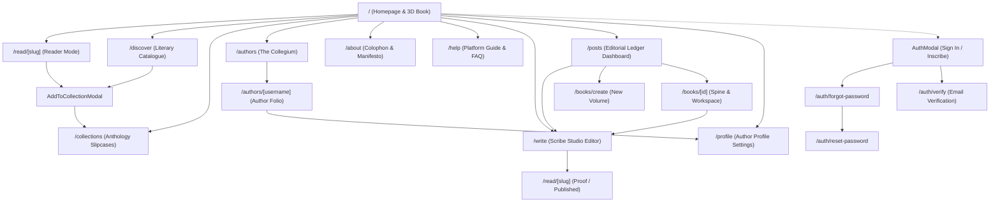

# INKFORGE — Page & Navigation Map

This document provides a code-grounded reference of all **17 App Router pages**, **27 API routes**, global interactive modals, and the comprehensive navigation architecture of INKFORGE.

---

## 1. Global Navigation Graph

---

## 2. Exhaustive App Router Pages Catalog (17 Pages)

### 1. Homepage (`/`)
- **File:** [`src/app/page.tsx`](file:///Users/kingpin/Documents/Vibecoded%20projects/inkforge/src/app/page.tsx)
- **Role:** Central application portal and visual signature.
- **Components:** `InkforgeLanding`, `PhysicalBook`, `Header`, lead essay card, gazetteer dispatches, curated contemporary anthology cards, thematic slipcases, scribe ledger metrics, master colophon.
- **Scroll Effects:** `.scroll-pop-reveal` on ribbon and boxsets, `.scroll-emerge-left` on lead story, `.scroll-emerge-right` on gazetteer, `.scroll-ink-reveal` on anthology header and colophon, `.scroll-stagger-child` on story cards.
- **Access:** Public.

### 2. Reading Surface (`/read/[slug]`)
- **File:** [`src/app/(reader)/read/[slug]/page.tsx`](file:///Users/kingpin/Documents/Vibecoded%20projects/inkforge/src/app/(reader)/read/[slug]/page.tsx)
- **Role:** High-immersion, distraction-free reading experience for published monographs.
- **Features:** Dynamic slug lookup from API/database with fallback to curated static monographs; real-time scroll progress ribbon (`% of monograph read`); reading time counter; paper tone selector; responsive margin notes and footnotes; bookmark to collection action; full-screen reading mode.
- **Access:** Public.

### 3. Scribe Studio Editor (`/write`)
- **File:** [`src/app/(studio)/write/page.tsx`](file:///Users/kingpin/Documents/Vibecoded%20projects/inkforge/src/app/(studio)/write/page.tsx)
- **Role:** Longform composition desk and document editor.
- **Features:** Rich block editor (`Tiptap`), AST JSON serialization, live word and character counters, autosave state badge (`Saved locally` -> `Syncing` -> `Saved`), local draft recovery and migration, optimistic concurrency conflict detection, revision history drawer, AI Copilot sidebar panel, publication modal.
- **Access:** Guest writing supported via local-first storage; authenticated sync to PostgreSQL.

### 4. Editorial Ledger & Posts Dashboard (`/posts`)
- **File:** [`src/app/(studio)/posts/page.tsx`](file:///Users/kingpin/Documents/Vibecoded%20projects/inkforge/src/app/(studio)/posts/page.tsx)
- **Role:** Central workspace ledger for managing manuscripts and book volumes.
- **Features:** Tabbed document filtering (`ALL`, `DRAFT`, `IN_REVIEW`, `SCHEDULED`, `PUBLISHED`); cloud sync badges; delete and edit shortcuts; book volume manager; direct links to `/write?id=[id]`.
- **Access:** Authenticated / Local session.

### 5. Literary Catalogue & Discover (`/discover`)
- **File:** [`src/app/discover/page.tsx`](file:///Users/kingpin/Documents/Vibecoded%20projects/inkforge/src/app/discover/page.tsx)
- **Role:** Search and exploration hub for all published monographs.
- **Features:** Debounced full-text search across titles and excerpts; topic filtering (`SYSTEMS CRAFT`, `LITERARY ECOLOGY`, `DIGITAL THEORY`); reading time filters (`<= 4 min`, `5–10 min`, `> 10 min`); sorting (`newest`, `readingTime`, `title`, `oldest`); server-side pagination; direct bookmarking modal.
- **Access:** Public.

### 6. Curated Collections (`/collections`)
- **File:** [`src/app/collections/page.tsx`](file:///Users/kingpin/Documents/Vibecoded%20projects/inkforge/src/app/collections/page.tsx)
- **Role:** Thematic slipcases and personal reading lists.
- **Features:** Split-view layout (volume list left, active anthology detail right); public anthologies vs personal reading lists tabs; new collection creation modal; remove monograph from collection; privacy toggles (`isPublic`).
- **Access:** Public viewing; authenticated creation and curation.

### 7. The Collegium: Resident Authors Directory (`/authors`)
- **File:** [`src/app/authors/page.tsx`](file:///Users/kingpin/Documents/Vibecoded%20projects/inkforge/src/app/authors/page.tsx)
- **Role:** Directory of registered authors and founding fellows.
- **Features:** Live registry fetched from database (`/api/v1/authors`); founding fellow profiles; total published monograph counts; direct navigation to author folios.
- **Access:** Public.

### 8. Author Folio (`/authors/[username]`)
- **File:** [`src/app/authors/[username]/page.tsx`](file:///Users/kingpin/Documents/Vibecoded%20projects/inkforge/src/app/authors/[username]/page.tsx)
- **Role:** Public profile and bibliography for individual authors.
- **Features:** Author biography, monogram avatar, affiliation, location, website link, inscribed monographs grid with reading times, owner-specific shortcuts (`Edit Profile`, `Open Studio`).
- **Access:** Public.

### 9. Book Workspace & Spine Inspection (`/books/[id]`)
- **File:** [`src/app/books/[id]/page.tsx`](file:///Users/kingpin/Documents/Vibecoded%20projects/inkforge/src/app/books/[id]/page.tsx)
- **Role:** Multi-chapter volume management desk.
- **Features:** 3D book inspection with live cover versions; chapter outline management; story bible notes; cover palette and AI generation panel; jump to chapter drafting.
- **Access:** Local / Authenticated author.

### 10. New Volume Inscription (`/books/create`)
- **File:** [`src/app/books/create/page.tsx`](file:///Users/kingpin/Documents/Vibecoded%20projects/inkforge/src/app/books/create/page.tsx)
- **Role:** Multi-step wizard for binding a new multi-chapter book.
- **Features:** Metadata entry (title, subtitle, description, genre, mood); book cloth palette selection (Crimson, Forest, Obsidian, Indigo, Amber); initial chapter outline setup.
- **Access:** Author.

### 11. Author Profile Settings (`/profile`)
- **File:** [`src/app/profile/page.tsx`](file:///Users/kingpin/Documents/Vibecoded%20projects/inkforge/src/app/profile/page.tsx)
- **Role:** Personal author colophon and account configuration.
- **Features:** Edit display name, username handle, biography, geographic location, portfolio website; account role inspection; authenticated session validation.
- **Access:** Authenticated users.

### 12. Colophon & Manifesto (`/about`)
- **File:** [`src/app/about/page.tsx`](file:///Users/kingpin/Documents/Vibecoded%20projects/inkforge/src/app/about/page.tsx)
- **Role:** Editorial philosophy and origin story.
- **Features:** Philosophical essays on software permanence; name symbolism (Ink + Forge); physical interface rationale; technical typography colophon.
- **Access:** Public.

### 13. Platform Guide & FAQ (`/help`)
- **File:** [`src/app/help/page.tsx`](file:///Users/kingpin/Documents/Vibecoded%20projects/inkforge/src/app/help/page.tsx)
- **Role:** Interactive documentation and user support.
- **Features:** Searchable FAQ accordion; category filtering (`Getting Started`, `Reading & Collections`, `Writing & Publishing`, `Account & Materials`); quick action guide.
- **Access:** Public.

### 14. Password Reset Request (`/auth/forgot-password`)
- **File:** [`src/app/auth/forgot-password/page.tsx`](file:///Users/kingpin/Documents/Vibecoded%20projects/inkforge/src/app/auth/forgot-password/page.tsx)
- **Role:** Self-service password reset initiation.
- **Features:** Email validation; rate limiting; cryptographic single-use token issuance; clear instructions.
- **Access:** Public / Unauthenticated.

### 15. Password Reset Commitment (`/auth/reset-password`)
- **File:** [`src/app/auth/reset-password/page.tsx`](file:///Users/kingpin/Documents/Vibecoded%20projects/inkforge/src/app/auth/reset-password/page.tsx)
- **Role:** Password update confirmation via secure token.
- **Features:** Token validation from URL query param; password strength requirements; secure scrypt hashing commit.
- **Access:** Public with valid token.

### 16. Email Verification (`/auth/verify`)
- **File:** [`src/app/auth/verify/page.tsx`](file:///Users/kingpin/Documents/Vibecoded%20projects/inkforge/src/app/auth/verify/page.tsx)
- **Role:** Email address ownership validation.
- **Features:** Single-use verification token redemption; email verification status commit to PostgreSQL; resend verification action.
- **Access:** Public with valid token.

### 17. Authentication Modal (`AuthModal`)
- **File:** [`src/components/auth/AuthModal.tsx`](file:///Users/kingpin/Documents/Vibecoded%20projects/inkforge/src/components/auth/AuthModal.tsx)
- **Role:** Global sign-in and account registration dialog.
- **Features:** Tabbed toggle between Sign In and Inscribe; input validation; credential submission to `/api/v1/auth/login` and `/api/v1/auth/register`; session cookie establishment; guest mode continuation.
- **Access:** Global trigger from Header.

---

## 3. Complete API Endpoints Catalog (27 Endpoints)

| Endpoint | Method | Role | Auth Required |
| :--- | :--- | :--- | :--- |
| `/api/v1/auth/register` | `POST` | Inscribe new author account | No |
| `/api/v1/auth/login` | `POST` | Verify credentials & issue session token | No |
| `/api/v1/auth/logout` | `POST` | Invalidate active session & clear cookie | Yes |
| `/api/v1/auth/me` | `GET` | Retrieve current authenticated user profile | Optional |
| `/api/v1/auth/verify-email` | `GET`, `POST` | Validate single-use verification token | No |
| `/api/v1/auth/resend-verification` | `POST` | Issue fresh verification token | Yes |
| `/api/v1/auth/forgot-password` | `POST` | Issue single-use password reset token | No |
| `/api/v1/auth/reset-password` | `POST` | Commit new password using valid reset token | No |
| `/api/v1/documents` | `GET` | List published or user manuscripts with filters | Optional |
| `/api/v1/documents` | `POST` | Inscribe new manuscript draft | Yes |
| `/api/v1/documents/[id]` | `GET` | Retrieve manuscript content and metadata | Optional |
| `/api/v1/documents/[id]` | `PUT` | Update draft content with optimistic lock | Yes |
| `/api/v1/documents/[id]` | `DELETE` | Delete or archive manuscript | Yes |
| `/api/v1/documents/by-slug/[slug]` | `GET` | Retrieve published monograph by unique slug | Public |
| `/api/v1/documents/[id]/publish` | `POST` | Publish manuscript to public catalogue | Yes |
| `/api/v1/documents/[id]/unpublish` | `POST` | Revert published work back to private draft | Yes |
| `/api/v1/documents/[id]/revisions` | `GET` | Retrieve immutable revision snapshot list | Yes |
| `/api/v1/collections` | `GET` | List public or user curated collections | Optional |
| `/api/v1/collections` | `POST` | Create new thematic collection | Yes |
| `/api/v1/collections/[id]` | `GET` | Retrieve collection details and item list | Optional |
| `/api/v1/collections/[id]` | `PUT` | Update collection metadata and visibility | Yes |
| `/api/v1/collections/[id]` | `DELETE` | Delete collection (preserves works) | Yes |
| `/api/v1/collections/[id]/items` | `POST` | Add monograph to collection | Yes |
| `/api/v1/collections/[id]/items/[postId]` | `DELETE` | Remove monograph from collection | Yes |
| `/api/v1/collections/by-post/[postId]` | `GET` | Check collections containing specific post | Yes |
| `/api/v1/authors` | `GET` | List all registered authors with post counts | Public |
| `/api/v1/authors/[username]` | `GET`, `PUT` | Fetch author folio or update profile | Public / Yes |
| `/api/v1/ai/copilot` | `POST` | Query advisory writing copilot suggestions | Optional |
| `/api/v1/ai/status` | `GET` | Verify AI engine health & key availability | Public |
| `/api/covers/generate` | `POST` | Generate procedural/AI book cover plate | Optional |
| `/api/covers/interpret` | `POST` | Extract visual mood from manuscript prose | Optional |
| `/api/covers/status` | `GET` | Check cover generation engine status | Public |
| `/api/v1/health` | `GET` | Production database & service health check | Public |
