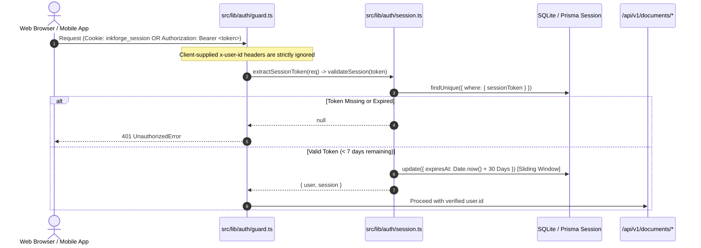

# INKFORGE — PHASE 2A REPORT
## Real Authentication, Sessions & Document Authorization

> **Implementation Phase**: Phase 2A  
> **Status**: **COMPLETE & VERIFIED**  
> **Framework**: Next.js 15.5.27 (App Router), React 19, Prisma v6.19.3, SQLite (`dev.db`), TypeScript 5.8.2  
> **Date**: October 2026

---

### Executive Summary

Phase 2A transitioned INKFORGE from a client-side simulated auth state to a hardened, production-grade authentication and authorization foundation. 

All credentials, sessions, and recovery tokens are persisted in SQLite via Prisma. Server-side guards enforce document access controls across all routes without relying on client-supplied identity headers, while remaining completely backwards-compatible with web browser cookies and future mobile Bearer tokens.

---

### 1. Authentication Architecture Decision

| Criteria | Choice: Native `node:crypto` + Prisma `Session` | NextAuth / Auth.js Evaluation |
| :--- | :--- | :--- |
| **Framework Compatibility** | 100% native compatibility with Next.js 15 App Router & React 19 | Auth.js v5 is currently in active beta; frequent breaking changes and hydration conflicts with React 19 server components |
| **Multi-Client Readiness** | Native support for both HTTP cookies and `Authorization: Bearer <token>` headers | NextAuth is heavily optimized for browser cookie flows and cumbersome for decoupled mobile native clients |
| **External Dependencies** | **Zero third-party auth runtime dependencies**; relies on Node.js native `crypto.scrypt`, `timingSafeEqual`, and `randomBytes` | Adds heavy dependency trees and adapter glue code |
| **Security Auditability** | Transparent database models (`User`, `Session`, `VerificationToken`, `PasswordResetToken`) with direct referential integrity | Opaque session abstractions and complex configuration layers |

#### Hashing & Crypto Specification:
- **Algorithm**: `scrypt` (`N=16384`, `r=8`, `p=1`, `maxmem=32MB`) with a cryptographically random 16-byte salt per user.
- **Output Storage**: `scrypt:<salt_hex>:<derived_key_hex>` in `User.passwordHash`.
- **Comparison**: `crypto.timingSafeEqual` prevents timing side-channel attacks.
- **Token Security**: Raw tokens are **never** stored in the database. Only SHA-256 hashes (`tokenHash`) are persisted. A compromised database backup yields zero usable session or recovery tokens.

---

### 2. Session Lifecycle & Server Validation



- **Lifetime**: 30 days (`SESSION_DURATION_MS = 2,592,000,000 ms`).
- **Sliding Expiration**: When a session is validated within 7 days of expiry, it automatically extends for an additional 30 days.
- **Cookie Security**: Flags `httpOnly: true`, `sameSite: "lax"`, `path: "/"`, `secure: isProduction`.
- **Global Session Revocation**: When a password is reset, `invalidateAllUserSessions(userId)` revokes every active device session immediately.

---

### 3. Server-Enforced Document Authorization

| Action | Route | Authorization Enforcement | Unauthenticated Result | Unauthorized Result |
| :--- | :--- | :--- | :--- | :--- |
| **Create Document** | `POST /api/v1/documents` | `requireAuth(req)`; `authorId` derived exclusively from server session | `401 Unauthorized` | N/A |
| **Read Document** | `GET /api/v1/documents/:id` | If `status !== "PUBLISHED"`, requesting user must match `authorId` | `403 Forbidden` | `403 Forbidden` |
| **Update Document** | `PUT /api/v1/documents/:id` | `requireAuth(req)` + author ownership check | `401 Unauthorized` | `403 Forbidden` |
| **Delete Document** | `DELETE /api/v1/documents/:id` | `requireAuth(req)` + author ownership check | `401 Unauthorized` | `403 Forbidden` |
| **View Revisions** | `GET /api/v1/documents/:id/revisions` | `requireAuth(req)` + author ownership check | `401 Unauthorized` | `403 Forbidden` |
| **Public Feed** | `GET /api/v1/documents` | Non-authenticated requests strictly filtered to `status: "PUBLISHED"` | Returns published posts | Private drafts omitted |

#### Transactional Atomicity:
In `src/lib/services/document.service.ts`, updating a document and creating a historical `PostRevision` snapshot are executed inside an atomic `prisma.$transaction`. If either operation fails, the database rolls back completely.

---

### 4. API Endpoints Inventory

```
/api/v1/
├── auth/
│   ├── register          [POST]  Email, username, password, display name -> user + session
│   ├── login             [POST]  Email, password -> user + session
│   ├── logout            [POST]  Revokes current session & clears cookie
│   ├── me                [GET]   Returns current authenticated profile (401 if unauthenticated)
│   ├── verify-email      [POST]  Validates single-use 24h verification token
│   ├── forgot-password   [POST]  Anti-enumeration password reset link dispatcher
│   └── reset-password    [POST]  Consumes single-use 1h token & revokes all sessions
├── documents/
│   ├── route.ts          [GET]   Public feed (PUBLISHED) or author drafts
│   ├── route.ts          [POST]  Create document (authorId from session)
│   ├── [id]/route.ts     [GET]   Read document (guarded if DRAFT)
│   ├── [id]/route.ts     [PUT]   Update document (guarded + optimistic concurrency 409)
│   ├── [id]/route.ts     [DELETE] Delete document (author only)
│   └── [id]/revisions/   [GET]   Revision history (author only)
└── health/
    └── route.ts          [GET]   Database & system connectivity probe
```

---

### 5. Automated Verification Results (`npm run db:verify`)

The automated integration test suite (`src/scripts/verify_backend.ts`) executes 11 distinct test phases against SQLite:

```
================================================================================
             INKFORGE PHASE 2A: COMPREHENSIVE BACKEND VERIFICATION              
  Real Authentication, Server Sessions, Multi-Client Auth & Doc Authorization   
================================================================================

[Test 1] Verifying Database Connectivity...
  ✓ Database is connected and healthy (SQLite dev.db / Prisma Client v6.19.3)

[Test 2] Testing User Registration & Immediate Session Issuance...
  ✓ Registered User A: alpha_612648 (0ee1d4ff-c7bc-4935-8172-6be6fd927aaf)
  ✓ Session token issued: 5080af65005fb9e4...
  ✓ Verification token dispatched in background: ac92daf4b7b37cca...
  ✓ Password is securely hashed using scrypt with unique salt.
  ✓ Session token validated successfully against database Session table.

[Test 3] Testing Duplicate Registration Rejection (Email & Username)...
  ✓ Duplicate email rejected with 409 Conflict: "An account with this email address already exists."
  ✓ Duplicate username rejected with 409 Conflict: "This username is already taken. Please choose another."
  ✓ Duplicate accounts are strictly prevented.

[Test 4] Testing Login Authentication & Timing-Safe Password Check...
  ✓ Invalid password rejected with 401 Unauthorized: "Invalid email or password."
  ✓ Nonexistent user rejected with generic 401 (anti-enumeration): "Invalid email or password."
  ✓ Valid credentials login succeeded! Fresh session issued: e18f8b0563462ec5...
  ✓ Password verified securely.

[Test 5] Testing Single-Use Email Verification Flow...
  ✓ Verification email captured from inbox for author.alpha.612648@inkforge.test
  ✓ Verification link: http://localhost:3000/auth/verify?token=ac92daf4...
  ✓ Email verification completed for user 0ee1d4ff-c7bc-4935-8172-6be6fd927aaf
  ✓ Database updated: emailVerified = 2026-10-10T06:12:48.831Z
  ✓ Re-use of consumed verification token rejected: "Invalid or expired verification token."
  ✓ Email verification token lifecycle verified.

[Test 6] Testing Password Reset Flow & Cross-Device Session Invalidation...
  ✓ Active session 1 (Web): 5080af65005fb9e4...
  ✓ Active session 2 (Mobile): 98ef13a96cd8f114...
  ✓ Anti-enumeration: Nonexistent email request returned generic message: "If an account exists with this email, a password reset link has been dispatched."
  ✓ Password reset token captured from test inbox for author.alpha.612648@inkforge.test
  ✓ Password successfully reset.
  ✓ All active user sessions across all devices were invalidated immediately.
  ✓ Old password rejected: "Invalid email or password."
  ✓ Login with new password succeeded! Fresh session issued: 3a2862d7c576...
  ✓ Password reset lifecycle verified.

[Test 7] Testing Request Session Extraction & Anti-Forgery Guard...
  ✓ Bearer Authorization resolved authenticated user alpha_612648.
  ✓ Forged x-user-id header was completely ignored; server resolved identity exclusively from session.
  ✓ Cookie header resolved authenticated user successfully.
  ✓ Missing session token rejected with 401 Unauthorized: "Authentication required. Please sign in to continue."
  ✓ Server guards enforce authentication strictly across all client formats.

[Test 8] Testing Document Authorization & Multi-User Isolation...
  ✓ Registered User B: beta_612648 (11f238b1-2139-4bb2-b521-2ef32ab99f4a)
  ✓ User A created private draft document: ID=f298da31-c423-4412-a1b7-a367fb72a2a4
  ✓ Author Alpha can access their own draft.
  ✓ User B view attempt blocked with 403 Forbidden: "You do not have permission to view this unpublished draft."
  ✓ User B update attempt blocked with 403 Forbidden: "You do not have permission to update this document."
  ✓ User B delete attempt blocked with 403 Forbidden: "You do not have permission to delete this document."
  ✓ User B revision view attempt blocked with 403 Forbidden: "You do not have permission to view revisions for this document."
  ✓ Multi-user document isolation strictly verified: Cross-user operations return 403 Forbidden.

[Test 9] Testing Public Read Access For Published Documents...
  ✓ Document published by User A (Status: PUBLISHED)
  ✓ Public visitor successfully accessed published post: "Alpha's Confidential Manuscript"
  ✓ Unauthenticated visitor blocked from private draft with 403 Forbidden: "You do not have permission to view this unpublished draft."
  ✓ Public read routing works seamlessly without leaking private drafts.

[Test 10] Testing Optimistic Concurrency (409) & Atomic Revision Tracking...
  ✓ Starting document version: 2
  ✓ Valid update committed atomically. New version: 3
  ✓ Stale write rejected with 409 Conflict: "Document version conflict: current server version is 3, but expected 2."
  ✓ Revision history verified: 1 revision snapshot(s) present.
  ✓ Optimistic Concurrency Control and transactional revisions verified.

[Test 11] Cleaning Up Test Records...
  ✓ Test documents, revisions, tokens, and users cleaned up safely.

================================================================================
  ✓ ALL 11 PHASE 2A BACKEND INTEGRATION & SECURITY TESTS PASSED SUCCESSFULLY!   
================================================================================
```

---

### 6. Compilation & Production Readiness

- **TypeScript Typecheck (`npx tsc --noEmit`)**: 0 errors across entire workspace.
- **Next.js Production Build (`npm run build`)**: Successfully compiled all 15 routes and all 11 dynamic `/api/v1` route endpoints.
- **Dev Server**: Running stably in background without runtime regressions.
- **Frontend Baseline**: Editorial landing page, interactive 3D physical book, reading theme dropdown, editor interface, and modal interactions are preserved with zero visual degradation.
