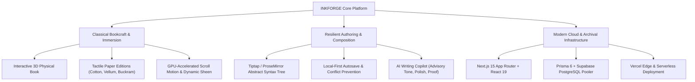

# INKFORGE — Technical & Operational Documentation Suite

Welcome to the definitive documentation suite for **INKFORGE**, an independent digital press and literary publishing platform engineered with modern web technologies, classical bookbinding physical metaphors, and long-horizon software architectures.

---

## 1. Documentation Index

This directory provides complete, code-grounded specifications and operational guides across the entire codebase:

| Document | Description | Primary Audience |
| :--- | :--- | :--- |
| [**`USER_GUIDE.md`**](./USER_GUIDE.md) | Complete handbook for authors and readers: reading modes, 3D book navigation, Scribe Studio, AI Copilot, autosave & revision recovery, collections, and publishing. | Authors, Readers, Editors, QA |
| [**`PAGE_AND_NAVIGATION_MAP.md`**](./PAGE_AND_NAVIGATION_MAP.md) | Code-grounded catalog of all 17 App Router pages, 27 API endpoints, interactive modals, buttons, and Mermaid navigation flow graph. | Frontend Engineers, Designers, Product |
| [**`ARCHITECTURE.md`**](./ARCHITECTURE.md) | Full system architecture, Next.js 15 App Router design, React 19 server/client boundaries, state management, AST serialization, and connection pooling. | Architects, Senior Engineers |
| [**`DATABASE.md`**](./DATABASE.md) | Prisma PostgreSQL database schema, data models, relations, cascade rules, indexes, baseline migrations, and Mermaid Entity-Relationship diagram. | Database Engineers, Backend, DevOps |
| [**`API_AND_INTEGRATIONS.md`**](./API_AND_INTEGRATIONS.md) | Comprehensive REST API reference: all 27 endpoints, authentication contracts, request/response JSON schemas, and HTTP error handling. | Full-Stack Engineers, API Integrators |
| [**`SETUP_AND_DEPLOYMENT.md`**](./SETUP_AND_DEPLOYMENT.md) | Local development setup, environment variables, Supabase connection pooling (port 6543 vs 5432), Prisma migrations, and Vercel CI/CD release pipeline. | DevOps, Release Managers, SREs |
| [**`TESTING_AND_KNOWN_ISSUES.md`**](./TESTING_AND_KNOWN_ISSUES.md) | Automated test suites (Unit, API integration, E2E deployment tests), verification commands, verified results, and browser/mobile quirks. | QA Engineers, Release Managers |
| [**`PROJECT_STRUCTURE.md`**](./PROJECT_STRUCTURE.md) | Exhaustive directory and file map, explaining the purpose of every folder, component, hook, library, and design token. | New Contributors, Code Reviewers |

---

## 2. Platform Overview

INKFORGE is built on three foundational pillars:

### Key Technical Specs
- **Framework:** Next.js 15.2.1 (App Router)
- **UI Library:** React 19.0.0
- **Styling:** Tailwind CSS v4 with custom `@layer base` CSS custom properties
- **Typography:** Bitstream Charter (Editorial Serif), System Sans, and Monospace Ligatures
- **Database:** PostgreSQL on Supabase via Prisma ORM 6.4.1 (with transaction pooler support)
- **Editor Engine:** Tiptap / ProseMirror with custom extensions and AST JSON serialization
- **Motion System:** GPU-accelerated CSS 3D transforms (`preserve-3d`, `rotateY`, `translateZ`) and IntersectionObserver-driven scroll reveals
- **Production Host:** Vercel (`https://inkforge-sigma.vercel.app/`)
