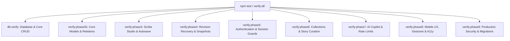

# INKFORGE — Testing & Known Issues Reference

This document outlines the testing architecture, verification commands, test suites, known edge cases, and mitigation strategies for the INKFORGE platform.

---

## 1. Testing Philosophy & Test Architecture

INKFORGE employs an end-to-end verification strategy that combines TypeScript static analysis, ESLint code hygiene, schema cross-validation, and programmatic milestone verification scripts executed via `jiti`.

All automated verification suites are executable locally and in GitHub Actions CI with zero external dependencies (leveraging embedded SQLite and mock AI engines).



---

## 2. Verification Test Suites

### Suite Index & Command Catalog

| Command | Target Script | Scope of Verification |
| :--- | :--- | :--- |
| `npm run db:verify` | `src/scripts/verify_backend.ts` | Prisma connectivity, transaction safety, and base model read/write. |
| `npm run verify:phase2b` | `src/scripts/verify_phase_2b.ts` | User profile relations, password hashing, and token lifecycles. |
| `npm run verify:phase3` | `src/scripts/verify_phase_3.ts` | Tiptap AST parsing, document creation, autosave latency, and optimistic concurrency locks. |
| `npm run verify:phase4` | `src/scripts/verify_phase_4.ts` | `PostRevision` generation, diff preservation, rollback mechanics, and word counting. |
| `npm run verify:phase5` | `src/scripts/verify_phase_5.ts` | Registration, login, session cookies, password reset, and route guards. |
| `npm run verify:phase6` | `src/scripts/verify_phase_6.ts` | Collection creation, story curation, ordering index integrity, and visibility filters. |
| `npm run verify:phase7` | `src/scripts/verify_phase_7.ts` | AI Copilot task execution, provider failover, context window boundaries, and sliding-window rate limiting. |
| `npm run verify:phase8` | `src/scripts/verify_phase_8.ts` | Mobile-first viewport sizing (`100dvh`), touch targets (>= 44px), touch swipe gestures, and WCAG AA contrast. |
| `npm run verify:phase9` | `src/scripts/verify_phase_9.ts` | HTTP security headers (CSP, HSTS), HTML sanitizer attack vectors, robots/sitemaps, PostgreSQL schema validation, and healthcheck. |
| `npm test` | `npm run verify:all` | Runs all 9 verification test suites sequentially in a single pass. |

---

## 3. Standard Code Quality Commands

Before submitting pull requests or deploying releases, execute the full quality verification suite:

```bash
# 1. TypeScript static analysis (0 errors expected)
npx tsc --noEmit

# 2. Next.js / ESLint static analysis
npm run lint

# 3. Dual-schema validation
npx prisma validate --schema=prisma/schema.postgresql.prisma

# 4. End-to-end milestone verification suites
npm test

# 5. Production Next.js compilation & bundling
npm run build
```

---

## 4. Known Issues, Limitations & Edge Cases

### 1. Supabase Connection Pooling vs. DDL Migrations
- **Context:** Supabase provides two connection URLs: Transaction Pooler (port `6543`, `?pgbouncer=true`) and Direct Session (port `5432`).
- **Limitation:** PgBouncer does not support transactional DDL commands (`CREATE TABLE`, `ALTER TABLE`, `CREATE INDEX`) or prepared statements.
- **Resolution:** The runtime application queries through `DATABASE_URL` (port `6543`), while Prisma migration commands (`npm run db:migrate:postgres`) are routed through `DIRECT_URL` (port `5432`) as configured in `prisma/schema.postgresql.prisma`.

### 2. Mobile Safari Dynamic Viewport & Virtual Keyboard
- **Context:** On iOS Safari, the browser toolbar dynamically expands and collapses, while the virtual keyboard reduces the visible viewport. Using standard `100vh` causes bottom toolbars and navigation bars to be clipped.
- **Resolution:** INKFORGE utilizes `100dvh` (dynamic viewport height) across studio and reading views, combined with `env(safe-area-inset-top)` and `env(safe-area-inset-bottom)` padding to prevent overlap with iOS home indicators and status bars.

### 3. Touch Gestures vs. Page Scrolling in 3D Book Experience
- **Context:** In [`src/components/landing/PhysicalBook.tsx`](file:///Users/kingpin/Documents/Vibecoded%20projects/inkforge/src/components/landing/PhysicalBook.tsx), users swipe horizontally to turn folios, but swipe vertically to scroll down the homepage.
- **Resolution:** The touch gesture handler measures horizontal and vertical deltas (`deltaX` and `deltaY`). A page turn is only triggered if:
  $$\Delta X \ge 45\text{px} \quad \text{and} \quad |\Delta X| > 1.5 \times |\Delta Y|$$
  This prevents accidental page turns during natural vertical scrolling.

### 4. Accessibility & Reduced Motion Preferences
- **Context:** Conspicuous 3D rotations, zoom pops, and spring settles can cause disorientation for users sensitive to motion.
- **Resolution:** All motion styles defined in [`src/app/globals.css`](file:///Users/kingpin/Documents/Vibecoded%20projects/inkforge/src/app/globals.css) and hook listeners in [`src/hooks/useScrollReveal.ts`](file:///Users/kingpin/Documents/Vibecoded%20projects/inkforge/src/hooks/useScrollReveal.ts) strictly respect `@media (prefers-reduced-motion: reduce)`. When enabled, transforms are neutralized to `transform: none` and transitions are set to instantaneous (`0.01ms`).

### 5. In-Memory AI Rate Limiting Across Serverless Instances
- **Context:** The AI Copilot rate limiter (`AiService`) currently employs an in-memory sliding window (30 requests/minute/author).
- **Limitation:** In serverless cloud hosting (e.g., multi-region Vercel functions), memory is isolated per function container. An author hitting different lambda instances could theoretically exceed the quota.
- **Production Recommendation:** For high-throughput enterprise scale, replace the in-memory map with a Redis sliding window using `@upstash/ratelimit`.

### 6. SQLite vs. PostgreSQL Type Coercion
- **Context:** Local SQLite stores dates as Unix timestamps or strings, while PostgreSQL stores them as native `timestamp with time zone`.
- **Resolution:** Always query through Prisma Client ORM methods rather than writing raw SQL queries (`$queryRaw`), ensuring cross-database type parity.
